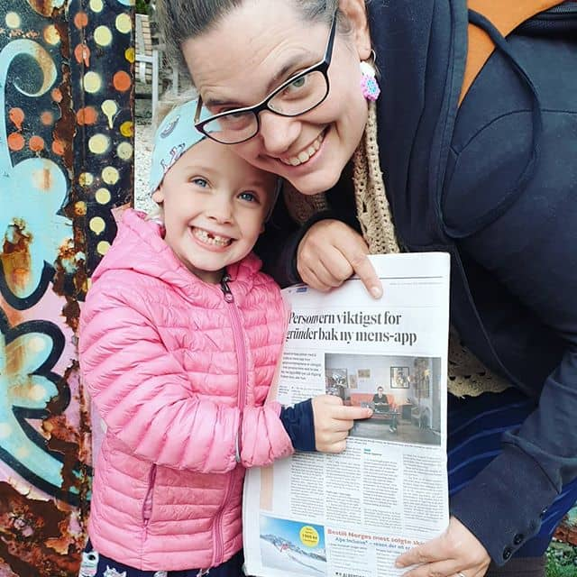

Hello you,

The last decade ended with a PANG!

After reading about the lack of privacy in menstrual cycle trackers, I asked myself, "A privacy-first web-based period tracker? Is it even possible?".

This seemingly innocent question led me to a talk on encryption in web applications held at 4 european tech conferences.

But also to the making of [POW! — take charge of your menstrual cycle](https://www.usepow.app/) 😱

*POW! in the Norwegian Financial Times*

If you are done with babymaking and would like to take charge of your menstrual cycle, please let me know if I could pick your brains and invite you into the messy beta phase...

- Benedicte

PS: The app will launch on March 8th, and you are invited to join me for launch brunch at my "home away from home": Vespa & Humla (Grünerløkka, Oslo).
