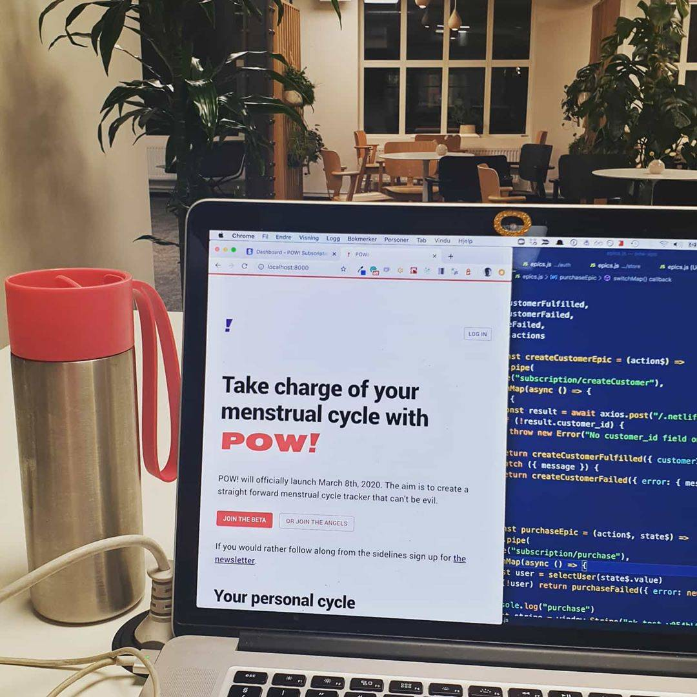
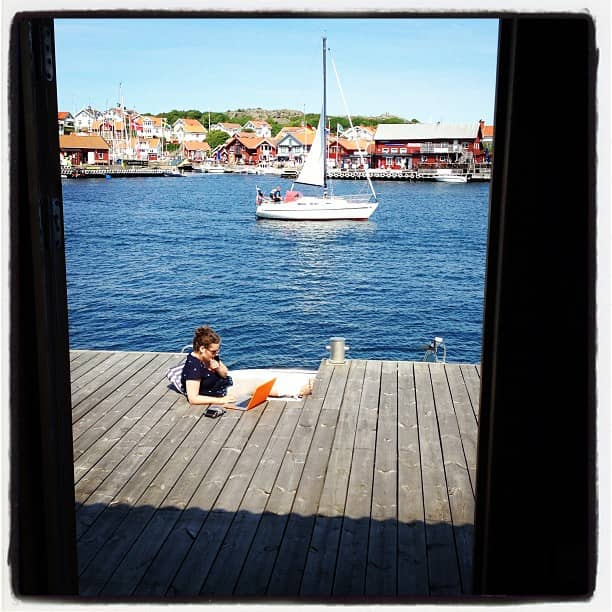

Hello to you this beautiful Sunday,

I am sitting at UMA, the co-working space I recently signed up for, writing this e-mail to you before I get on with coding the payment flow for POW! - take charge of your menstrual cycle.

Back when I quit my first and only proper job, I thought I would never step into an office environment again.

Fast forward six or seven years, I found myself working from a cubicle creating a web application for the Swedish Armed Forces as a subcontractor for Thales.

The plan was to create the prototype and bolt! Three years later, I am still at Thales part-time. It turns out I have changed, or maybe more correctly, life has changed.

Being in an office has its perks: lunch, coffee, quite and grown-ups ;)

It also helps, of course, that the team, the client, the client's client, and the project are a great match.

I will probably still work from home, on the road, the cabin, and my home-away-from-home Vespa & Humla.

But I realized if I was to get the show named POW! on the road by March 8th, I needed somewhere to focus on just my work.

No lunch at the co-working, but plenty of coffee, quiet and space.

- Benedicte

PS: Let me know if you would like to be invited to the POW! launch brunch on Sunday, March 8th, at my "home away from home": Vespa & Humla (Grünerløkka, Oslo).
