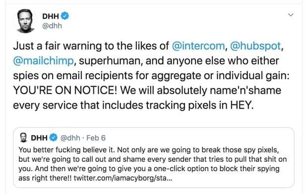

Hello,

You have probably heard of the email killers like Slack, Basecamp, Discord, and all the other project management, chat, and forum tools out there.

But email never died, and marketers love it!\
It lands right there in your inbox.

And all these emails track you. Yes, even this email does!\
I can see if you opened it, when you opened it and where you were when you opened it.

This is done using a tracking pixel. It is a tiny 1x1 pixel image that is located on the server of the newsletter provider. The provider can then track traffic to this image and give me info about your behavior.

With the newsletter provider I use, I cannot turn this off. In some, you can, but it is buried far into the settings.

Why am I talking about this today?

Well, Friday @DHH (Billionaire, Creator of Ruby on Rails, Founder & CTO at Basecamp, Co-Author of Rework) went on a crusade against this type of tracking.

And he is not just talking the talk, he is coding the code.

The Basecamp team is creating a new email service. One that blocks tracking pixels and calls out any provider that includes them, in addition to other yet to be disclosed features.

[It's launching in April, it's called HEY.](https://hey.com/)

Will you pay for a better email experience?

- Benedicte
