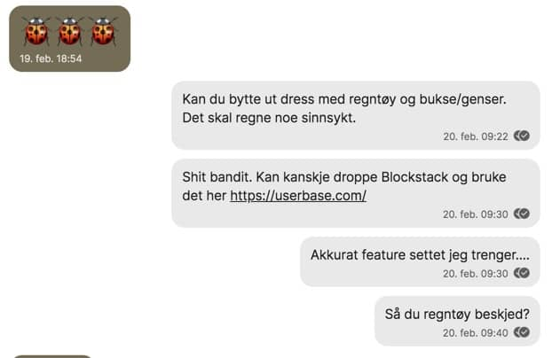

Hello there,

You might have missed me last Sunday, probably not, but it makes a good introduction to this email.

On February 20th, with 2,5 weeks to go until the launch of POW! I found Userbase (userbase.com), a backend that makes syncing encrypted user data between devices a breeze.

*A little convo from me to Ola about Userbase and rainwear for Lillian at kinderegarten...family business FTW.*

I didn't know about the easy syncing, only the encrypted user data part, at the time. But my gut feeling told me I needed to give this a serious look.

Userbase is bootstrapped like POW! With a focus on creating a robust set of core features that creates value for its customers.

Switching a core piece of technology so close to launch is just one of does things one does not do. But I decided to listen to my gut...

And I am delighted I did. Userbase is an excellent fit for POW! and with the mentioned "automagically syncs user's data between devices" feature I ended up removing a lot of code 👍

Userbase will hopefully also grow with POW! and its needs as they are relatively new as well. The code is all open-source, so if anything unforeseen happens, I could host it myself.

So, in the frenzy of creating my proof-of-switching last weekend, I forgot all about sending you last week's edition of this newsletter.

I am sure you forgive me ;)

- Benedicte

PS. Seven days to go until International Women's Day and the launch of POW!
