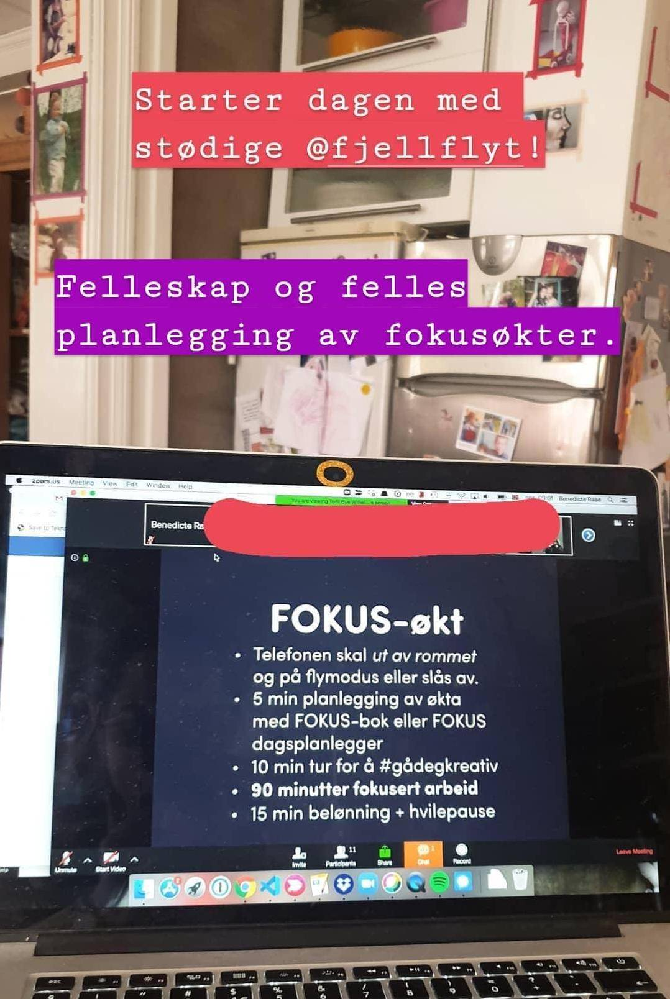

Hello you,

It's been three weeks already since the launch of POW! and my last email. Safe to say most of us have had our worlds turned upside down since then.

Those who know me well know I am very pragmatic, so much so that some people will read me as insensitive, so I decided to lay low and focus on delivering the hours I had promised my largest client.

Even though I am used to working from home, in these strange times, I have really appreciated being a part of the Slow Business community.

Especially our morning planning session every day at 08:30 has been a valuable anchor in my day. In those, we plan our day together and get a little pep talk from our leading lady Torill.

Join us!

Either by [buying a week's access](https://fjellflyt.simplero.com/products/102582-Coworking-med-Fjellflyt),\
or join us [tomorrow on Facebook live](https://www.facebook.com/events/685788438914024/).

If you would like this, but in English and on a US timezone, let me know, and maybe we can get Torill to create one for you.

Just to be clear, this is not paid advertisement, I pay to be a part of those morning sessions and the Slow Business Master Mind ;)

- Benedicte
