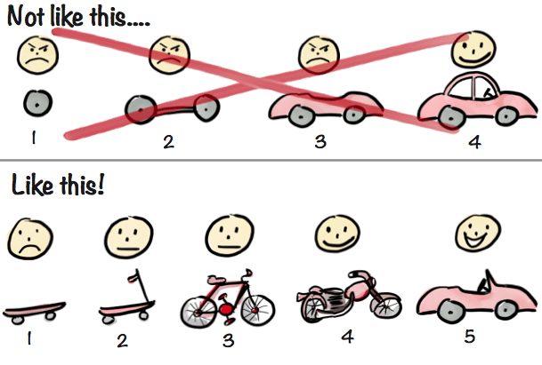

Hello from sunny Oslo,

We have finally turned that elusive corner that is spring, and it always surprises me how wonderful I find it every year.

☀️➡️😍

Last week I used terms that might have been unfamiliar to you. That's on me. Going forward, I am hoping to empower non-coders to create apps and digital services without learning to code. If I am going to succeed, I need to learn how to communicate and teach without jargon and acronyms.

Practice makes perfect, or at least a little bit better...

So let's revisit the term **MVP (Minimal Viable Product)**.

I quite like this definition I found on [Wikipedia](https://en.wikipedia.org/wiki/Minimum_viable_product):

"A minimum viable product (MVP) is a version of a product with just enough features to satisfy early customers and provide feedback for future product development."

Very often, you can create this version yourself out of existing building blocks. Saving you both time and money. Good developers are hard to come by, and even simple tech projects are costly.

I also often come back to this image.

We, or at least I, often want to make each foundational piece perfect. But what if it turns out that nobody wants to get from A to B faster after all?

So, what is the skateboard version of your idea?

- Benedicte

🇳🇴**Vil du å lage din egen prototype?** Sjekk ut mitt rykende ferske opplegg "[Gjør det selv Master Mind](https://www.notion.so/lillylabs/Gj-r-det-selv-Master-Mind-baa6cf557d1d4f67893b215bb8e70391)". Oppstart 27. august (og 7. mai for deg som liker å teste nye greier).
