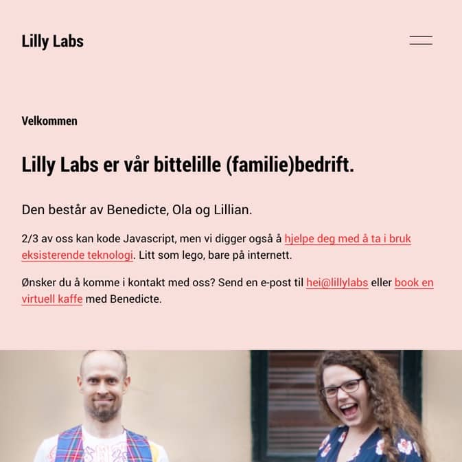
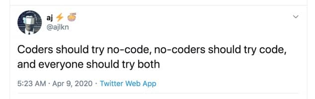

Finally peeps,

Lilly Labs got a website again. Checkout out [lillylabs.no](http://lillylabs.no/). It's in Norwegian, but there are some fun pictures. Especially on the POW! page.

I am thinking of incorporating some "trips down memory lane"-pages. We've been at it for 10 years this fall 🎉

I often feel like two people. I have two identities in away. There is Biz-Benedicte, and there is Dev-Benedicte.

I love to code, and as a developer, I want to hand-code everything. While Biz-Benedicte is more about getting things done with the correct, or at least good enough tool, for the task.

After touting no-code tools over the last weeks and wanting to get my hand dirty, I set out to make our web site in Squarespace.

If you are a developer, you probably just cringed inside. And Dev-Benedicte is still hiding from embarrassment.

But Biz-Benedicte had so much fun. And it is such a long time since I had fun like that on the Internet. I could focus on the content and even had fun writing. Who even is this person?!?

- Benedicte

🇳🇴 Første runde med "Gjør det selv" starter Torsdag. Deltagerne så langt skal lage kart-apps. Vil du lage kart-app? Svar på denne eposten!
