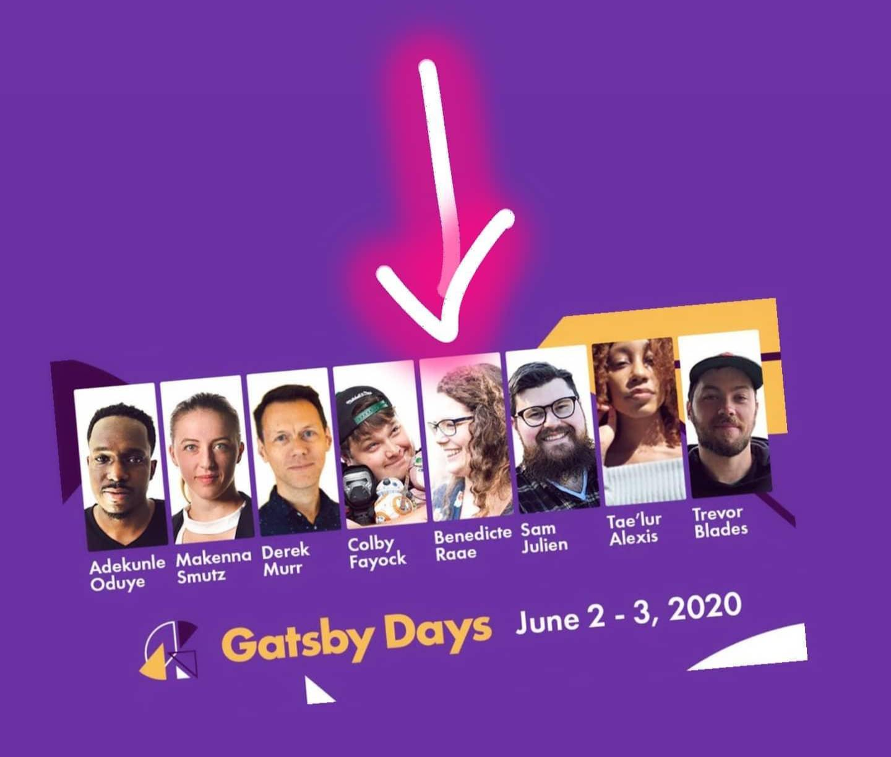

Hello again,

Today I am in your inbox to tell you that I will be speaking at the first-ever [Virtual Gatsby Days on June 2-3](https://www.gatsbyjs.com/virtual-gatsby-days-registration/).

Very excited!

Gatsby is the framework we use to create the frontend for POW! And together with Userbase, as the backend, we have ourselves an encrypted menstrual cycle journal.

[Gatsby](https://www.gatsbyjs.org/) + [Userbase](https://userbase.com/) will be the topic of my talk, and I hope to see some familiar faces (or more likely names, I guess) among the attendees.

- Benedicte
