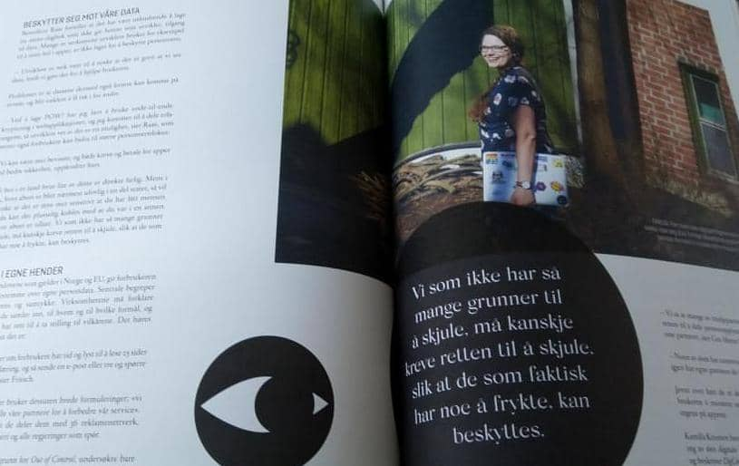

Hello there,

Tomorrow its been three months since the launch of POW!

This is the first of hopefully many many future POW! monthly updates, as I have stated before, I am in it for the long run with this one.

**Stats**

Since launch POW! has acquired 24 customers.\
8 of these came in the month of May.

**Marketing**

POW!, or rather I, was featured in an excellent article by freelance journalist Marit Moe Disteler in the latest issue of Altså. It was all about privacy in apps.

Quote pictured: "We who have nothing to hide, should maybe demand the right to privacy so the people who have something to fear may be protected."

I have not done much marketing since the launch, unfortunately.

When Corona hit, I kind off fell off the social media roll I was on, and it's been harder to get back on than I expected.

I ended up consuming too much, and creating too little. Almost a week ago, I banned myself from all of them.

And let me tell you it's already working. To early to spill any beans, but I recommend you try if you feel your creativity is dwindling.

**Product**

No significant changes to the product since the launch. I have fixed some user interface bugs, and Ola has made it possible for users to change their email address.

**Plans for June**

Revamping the main screen to make it easier for users to move forward and backward in time.

Set up an email welcome sequence for new customers to help them get started and to gather some info about how they found POW!

Until next week,\
Benedicte
