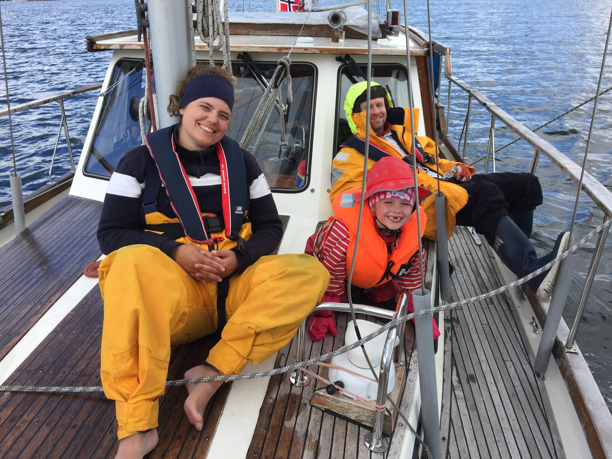

Hello there,

After weeks of sun, sun, sun, and almost unbearable heat, the weather turned just in time for the most common summer vacation weeks here in Norway ☔︎

But as the Norwegian saying goes: "There is no bad weather, only bad clothes".

Both Ola and I have sailing experience, Ola more than most. He grew up sailing and actually met our Captain Allister on the island of Barbados, after both had sailed across the Atlantic, back in 1999.

It was a joy to see how intern Lillian took to sailing; children really are the best newbs :D

Allister will be off again tomorrow with his band [Villa Cortado](https://www.villacortado.no/), performing their way down the Norwegian coast, while we are looking forward to summer hours here at Lilly Labs HQ.

Those hours include time for social distancing fun times in the courtyard. So if you find yourself in Oslo over the next three weeks, let us know and join us for a coffee or barbeque session.

A new parasol was just delivered, and I think/hope it might even protect against the rain.

Until next week,\
Benedicte.

PS: For an explanation of the term **newb**, [check of my latest Vocab Wednesday video on YouTube](https://youtu.be/kWJUMW0iUag).
