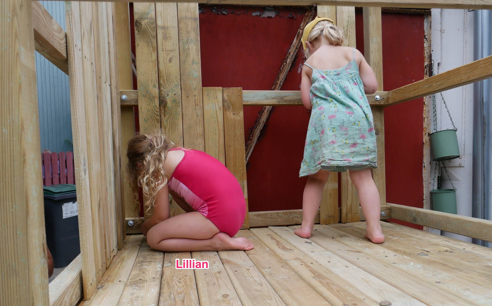

Hello,

Full summer mode here at Lilly Labs HQ, so much so that I completely forgot it was Sunday yesterday.

It was one of those perfect summer days:

- I did some coding work on POW!
- We all did some work on Lillian's play tower.
- Friends came over for a barbeque,
- and did some work on the play tower.

This summer is not turning out so bad, after all.

I hope you are doing well, and the invitation still stands to stop on by if you find yourself in Oslo.

*Work hard, play hard ;)*

**The monthly POW! Update**

There have been some new subscribers in June and some cancellations. Leaving us at negative one subscriber (23 subscribers) since the last update.

When working on the revamp for the main screen, I concluded I had to make some changes under the hood. If you are very interested in me going back and forth, and back again on this, I made a [YouTube video that day](https://youtu.be/4LsX_qa5BAQ).

Visible improvements to the main screen should be completed this month!

Setting up an email welcome sequence did not happen 🙈

I did, however, create the first [POW! Monthly Update on YouTube](https://youtu.be/eRTJPIa39a4)

Until next week, Benedicte
