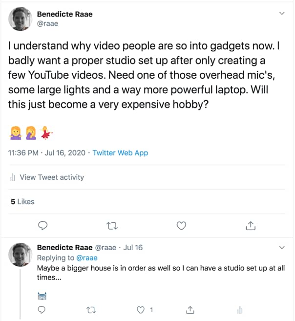

Hello,

We are midways in the typical Norwegian summer vaction weeks.

The weather is all over the place, and as one does in this country, Lilly Labs is moving into a tiny cabin with another family of five for the next week.

But I digress, the subject for today is "We need a bigger house"!

Why?

Well, I need a YouTube studio...

Just to make sure we are all on the same page, this is a joke. At least partly 🙈

Making videos are so much fun but super time consuming, and it does make you want gear you never even knew existed.

You might remember I was supposed to speak at Gatsby Virtual Day. It was turned into a content series. Next week, my video on *Gatsby + Userbase = Encrypted menstrual cycle journal* will drop, and I had some fun and [created a trailer for it](https://youtu.be/04GvDiePqmE) ;)

My challenge this fall is too not let it take up too much time or money. The goal is to keep it a fun and creative outlet. Nothing more.

My One Thing ([link to book](https://www.the1thing.com/)) is POW! — The flexible and private menstrual cycle journal.

- Benedicte
