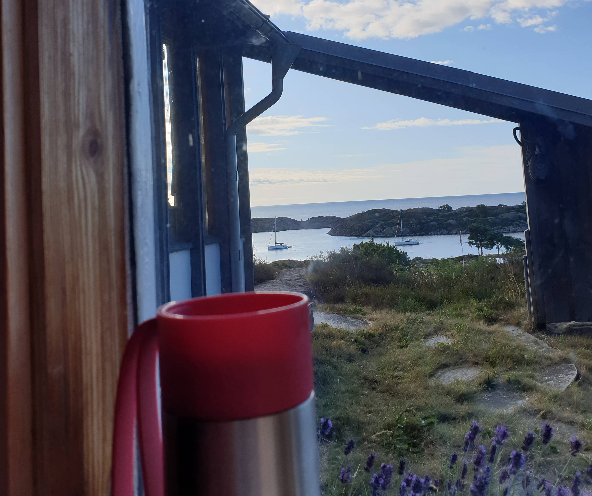

Wow,\
were we in for a treat this week!

Five days of working (a little) and playing (a lot) from my mother's summer cabin.

Waking up to this view never gets old.

Bringing along another family kept our little intern Lillian very much occupied in the mornings, leaving Ola and I time to do some work.

On Tuesday, my Gatsby Virtual Days talk turned YouTube video on [Gatsby + Userbase = Encrypted Menstrual Cycle Journal [8 min]](https://youtu.be/kKp7Syxyxnw) was released.

Summer is coming to an end.

It has been a good one, but I am also looking forward to the rhythm of everyday life and ramping up work on POW!

- Benedicte

PS: There is also a new [Vocab Wednesday video out on ENCRYPTION [2 min]](https://youtu.be/7pysrHM-36Q).
