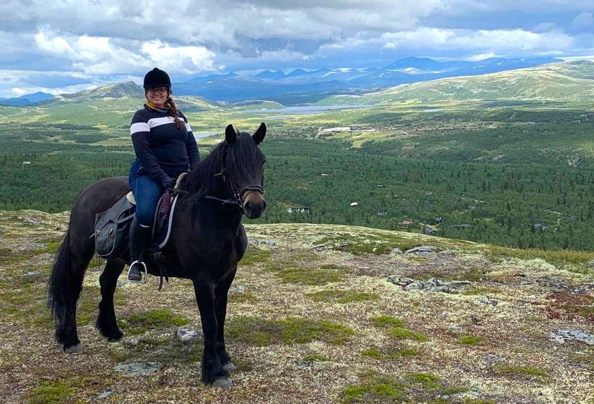

Hello,

Summer is coming to an end here at Lilly Labs HQ.

I can't believe it's August already, can you?

However after a relaxing summer ending with a week of horseback riding in the mountains, I am ready to crank it up. Dare I say #hustle even.

The plan is to split my time evenly between POW! and my current client, sprinkling in YouTube as a hobby.

Fall always feels like more of a new beginning than January to me. Stuck in the academic year forever, it seems.

And my (academic) new year resolution is to not act on any new ideas, just write them down and leave them be for later.

My One Thing¹ this fall is POW! and as the obliger² I am I need to let you know to keep myself accountable.

If you also need some external accountability, please feel free to reply with your focus for the fall. And I will ping you every now and then about it.

- Benedicte

**Footnotes**

¹ From the book, [The ONE Thing](https://www.the1thing.com/), where the author talks about focusing on the one thing you can do such that by doing it, everything else will be easier or unnecessary.

² From the book, [The Four Tendencies](https://gretchenrubin.com/books/the-four-tendencies/intro/), a framework for understanding how people respond to expectations.

**YouTube videos released this week**

- [A day in June // Learning to vlog](https://youtu.be/P-4FUbiLv4Q)
- [Vocab Wednesday // Encryption Key](https://youtu.be/uf_WpyZUgY4)
