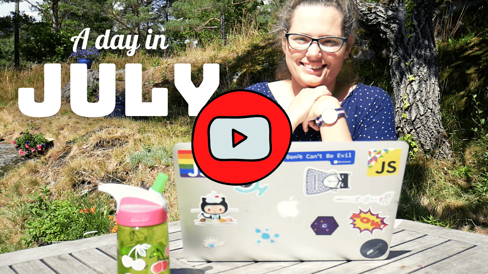

Hello,

If you are still sheltering in place, maybe not read this one...

.\
.\
.\
.

Ola and I meet up with our Slow Business Master Mind Thursday to Saturday in the Norwegian mountains.

And while I was there, I finally finished up the ["A day in my life" from July [You Tube]](https://youtu.be/fpFY82efGPI). Fittingly enough, another workcation.

I just really love a good workcation.

Sometimes, even more than a "proper" vacation.

Maybe because I know I can double my vacations if they are workcations.

Maybe because I never bring the "boring" work on a workcation.

Maybe because I love filling my cabin with people, but having to spend 24/7 with them is just not an option.

Maybe because working in a different location, weirdly does not feel like work.

But never expect to work a full week, even if you go alone. There will always be some kind of hick up.

And if you are going with others, make double sure they know you will be working. It can also be wise to add when and for how long.

Otherwise, they might interpret, "I will be working on this trip" as "She will check email every now and then," while you meant "I will be on my laptop coding 3-4 hours every morning".

Do you go on workcations? Do you like them?

Until next week,\
Benedicte

More videos available on YouTube:

- [A day in my life (July) // September 3rd](https://youtu.be/fpFY82efGPI)
- [Channel Update // August 18th](https://youtu.be/yCOH1zxMlGc)
- [POW! Status Update // August 8th](https://youtu.be/IFf8hFWR8J8)
- [A day in my life (June) // July 31st](https://youtu.be/P-4FUbiLv4Q)
- [Gatsby Days Trailer // July 18th](https://youtu.be/04GvDiePqmE)
- [POW! Status Update // July 8th](https://youtu.be/eRTJPIa39a4)
