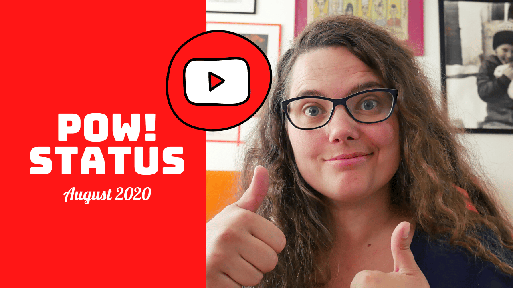

Hey,

POW! had been live for six months already.\
That is half a year, can you believe it?

As always, I created a [POW! Status](https://youtu.be/VK3_ItTBw6I) video.\
Because doing something three times constitutes as always, right?

The highlights from August are:

- 12 new customers, 39 in total 🎉
- My good friend, and [often partner in crime Marit](https://www.maritletnes.no/about), is back from maternity leave and will be helping out with user testing and user insight.
- I created a master plan on paper for the months left in 2020.

And watch all the way to the end of the video if want to hear about me fixing a common comlaint from users, or so I thought...

The focus mobing forward is more contact with exciting users to pinpoint what is working and what is not working.

- Benedicte

Past POW! Status videos:

- [POW! Status // July 2020](https://youtu.be/IFf8hFWR8J8)
- [POW! Status // June 2020](https://youtu.be/eRTJPIa39a4)
