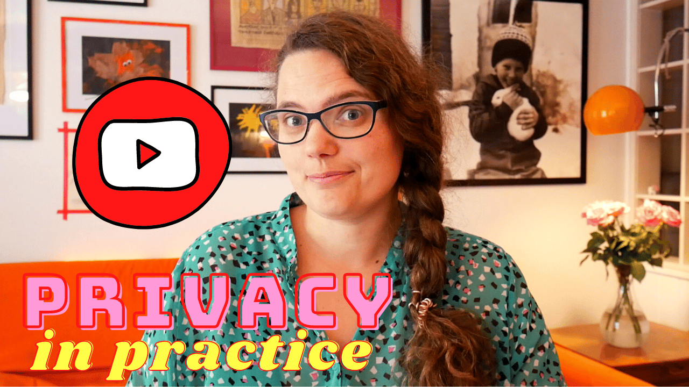

Hello,

It’s Sunday again 😁

I started a new series on YouTube, and now also here in the newsletter that I am calling Privacy in Practice. You can expect it once a month.

In this first one, I share some thoughts around privacy-first when it comes to tools and services we often use when making an app.

You may [watch the video](https://youtu.be/X-9_-w7HFh0) or read this email. It’s the same content, just different formats.

When I started looking into how to make POW! privacy-first I quickly realized all data in such an app should be end-to-end encrypted.

This is the only way to assure that neither I nor anyone else except the user can access the saved data in a readable form.

After months of research and four talks on encryption in the web browser, I stumbled upon Userbase. This backend-as-a-service handles all the logistics of encryption for me.

So with encryption solved, was I done thinking about privacy?

Not really, there is more to privacy-first thinking than encryption.

As developers, we have gotten so used to tools and services collecting “useful” data that we forget to question it from a privacy perspective.

For instance, with POW! even logs on when and how often you visit the app might say something about your cycle. And to be honest, I am not sure how much of this type of information Userbase logs and for how long.

Its obviously better than some of the competitions that send cycle events straight to Facebook, but none the less something I need to be on top of and question.

I have tried to categorize the relevant services into four main categories and collect some thoughts on each.

**Website Analytics**

Often Google Analytics is slapped on any and all web projects. However, do we really want to feed more data to Google? And do we really need the level of detail it provides?

For all my projects these days, I use Fathom, a privacy-first analytics tool.

Fathom, and its competitors are GDPR and CCPA compliant by virtue of not collecting data considered personal, such as IP addresses. And since there is no need for a cookie, there is no need for a cookie banner.

Also, the user experience for me is so much nicer. Since Fathom collects less data, there is less noise when checking the stats and making decisions.

A win, win, win.

**Billing**

As soon as you bill someone traditionally, they can no longer be anonymous. The purchase will show up on credit card statements.

When I log into our payment provider Stripe, I can see your full name and the country of origin for your credit card.

For POW! this might be an issue for someone in an abusive relationship or family situation who wants to take control of their cycle without others knowing.

I have no solutions to this, as of now. Still, we would like to accommodate the above scenario and menstruators who cannot afford POW! at some point in the future.

As a side note, moving all purchases to credit cards have a significant privacy impact. For instance, it’s much harder to disguise sexual orientation or political views when all your purchases are linked to you.

**Marketing Automation**

I would like to automate some of the marketing for POW! I would like to send a welcome email to new customers. And I would also like to send them periodic updates on the app and the advances in menstrual health research.

However, doing so in a privacy-first kind of way is not easy.

I looked at several services, and only Mailchimp lets you disable tracking. But you have to do it for each and every email. Convertkit and some other services allow you to turn it off for the whole account, but you must send an email to support to get it done.

Most of the tools, especially the more advanced ones, also encourage tracking as much as possible. With no references to privacy, more data always equals better in their marketing copy.

I do not really need to know when someone opened a marketing email, or precisely what link they clicked. I might share something about a sensitive subject. Would it not seem unfair that I also then tracked your behavior around that subject?

Can someone please make the Fathom of marketing automation?

And yes, I know there will be much less to automate around if done in a privacy-first way. But I would welcome the simplicity.

**Application Monitoring**

POW! needs some type of application monitoring.

It would be nice to get reports when something goes wrong automagically, and not having to wait around for users to report errors.

But I am scared I might accidentally disclose private information through such a service.

I have been looking at Sentry, and I think I can implement it in a way I am comfortable with. But I must be vigilant.

For instance, Sentry captures user interactions so that it can be added to the error report making it easier to figure out what went wrong.

For privacy reasons, they do not capture input, good on them. But if a user clicks a button with the id “cramps” is tracked, then this does leak private data. Especially if I followed their advice to connect interactions to specific users.

---

I hope this was a helpful summary of things to consider when making a privacy-first app.

As you gather, I do not have all the answers, yet 😉

Did I forget anything? Do you have any tips? Was anything unclear?

Please send me a reply! I welcome all feedback.

- Benedicte
