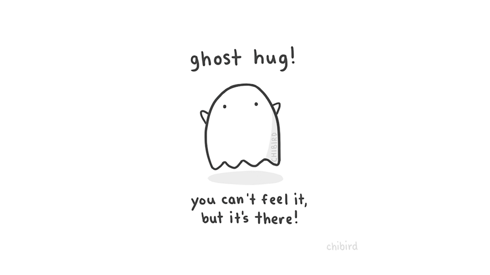

Hello,

I had something entirely different planned for today, scheduled and ready to go days ago (yeah me and project getting ahead and delegating more).

But then the Internet reminded me that on this day last year, I spoke at JSConf Budapest.

JSConf Budapest is extra special to me because they were the first conference to accept my talk, "A privacy first period tracker? Is it even possible".

And that talk lead me to make **POW!**

And I had kind of thought I would be back on the speaker circuit this fall.

And that made me want to say something interesting or profound about the situation we are all in.

But there I am at a loss.

All I will say is that hopefully, by next fall, we can hug our friends and make new friends at conferences all around the world.

Until then...

Until next week,\
Benedicte

PS: The talk is [available on YouTube](https://youtu.be/nS36D2zUkvA), all the way at the end, little intern Lillian (4,5 at the time) joins me on stage.
