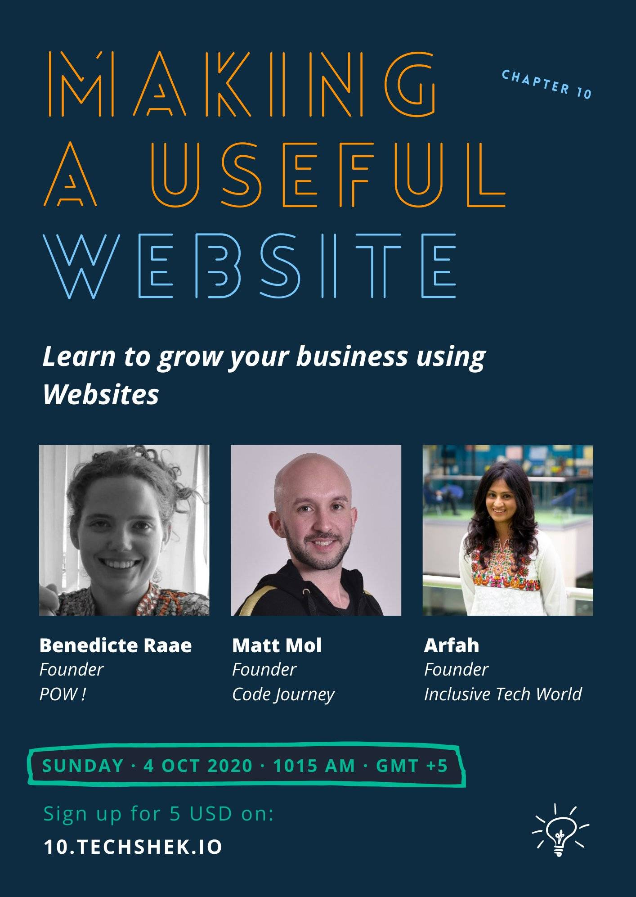

Hello again,

Yesterday I kind of started my day in Pakistan.

I got up super early (at least for me) so I could attend and speak at Tech Sheck #10 about creating a useful website or web app in my case.

It's a local Pakistani meetup turned virtual, and the organizer found me on Twitter.

And then sometimes the world just feels a little bit smaller and a little more connected.

Today the recording of the [meetup went live on YouTube](https://youtu.be/wivthHE6i_g). There are three talks with a QA session after each. Me, Mat Moll from Argentina and Arfah from the UK.

But most of all, I recommend the [summary by 16-year-old co-organizer](https://youtu.be/wivthHE6i_g?t=5613) Aashir where he mentions how he has found his happy work in front-end-coding.

Fining your happy work is essential,\
I think I have found mine in POW!

What is yours?

- Benedicte
