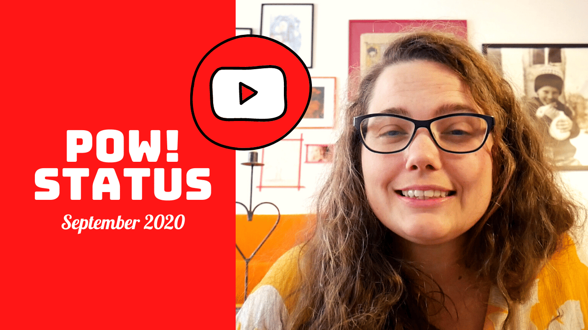

Hello,

Another month, another POW! status update.

While August was a fun month with 12 new customers, September has been more of a boring one:

- 5 new customers and 5 cancellations, so standing still at 39 customers.
- Finally, moved the marketing pages to Squarespace.
- I tried out an email service that lets you turn off tracking (link clicks and opens) on an account level.
- Ola finished the code that enables a user to change their password.
- Marit planned a full day of user testing for existing users, but also one for potential users in November.

If you are a potential POW! user, have time on November 6th during European business hours and would like 6 months for free (or just want to help out), [then please book a slot through Calendly.](https://calendly.com/raae/pow-user-testing-2?month=2020-11)

Here's to a more exciting October,
- Benedicte

**Past POW! Status Updates:**

- [August 2020](https://youtu.be/VK3_ItTBw6I)
- [July 2020](https://youtu.be/IFf8hFWR8J8)
- [June 2020](https://youtu.be/eRTJPIa39a4)
