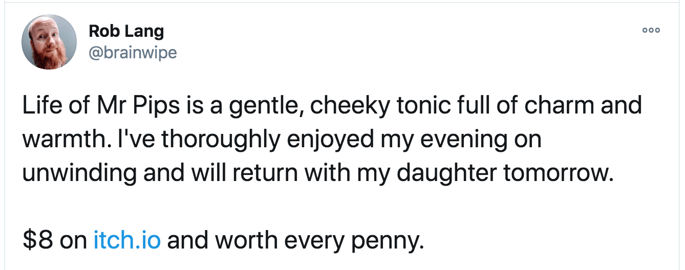

Hello,

Friday, I did something I never thought I'd do, [I live coded on a stream](https://youtu.be/70CpQRiOep8) adding a feature to POW!

Live coding has been something I have pretended I had no interest in because secretly, I was just way too scared to do it and a little jealous of the people who do dare.

Luckily, I am old enough to call my own bullshit and accept help, at least every now and then. Being scared is not a good reason for not doing something.

I am pretty sure I would have kept on postponing had it not been for interwebz friends, game developers, fellow Norwegians, and readers of this newsletter Clare and Christer of Snuti!

They are live streaming pros after a year of streaming the making of their indie game Mr. Pips.

Before scheduling my stream, I got to chat through it all with them, and they also showed up in the chat while I was streaming, helping me along.

A big thank you to Snuti.\
[Go buy their wholesome game](https://snuti.itch.io/the-life-of-mr-pips); it has gotten rave reviews.

And if there is something you are scared to do, maybe I can help?\
Hit reply, I am ready to pay it forward.

- Benedicte

PS: I will keep [streaming every Friday](https://www.youtube.com/playlist?list=PL9W-8hhRoLoOwzCi5n823vZvCGtPM1eXJ) for a while before deciding if this is something for me long term or not.

PPS: Speaking of scary, I am on a panel titled [Female Founders: Starting a sucessful women-owned business in the US and Europe](https://europe.unc.edu/event/female-founders/) on Tuesday.

**YouTube Videos**

- [Privacy-first website analytics tools](https://youtu.be/u6Wkw7Wj-3Y) // Privacy in Practice - #002
- [Kind of a boring month](https://youtu.be/kFIztSAik7E) // POW! Update - September 2020
- [Privacy-first is more than encryption](https://youtu.be/X-9_-w7HFh0) // Privacy in Practice - #001
- [Getting organized and getting help](https://youtu.be/VK3_ItTBw6I) // POW! Update - August 2020
- [A perfect day in July](https://youtu.be/fpFY82efGPI) // Vlog
- [Passing 1000 USD in revenue](https://youtu.be/IFf8hFWR8J8) // POW! Update - July 2020
- [A day in June](https://youtu.be/P-4FUbiLv4Q) // Vlog
- [Why make POW! and plans](https://youtu.be/eRTJPIa39a4) // POW! Update - June 2020
