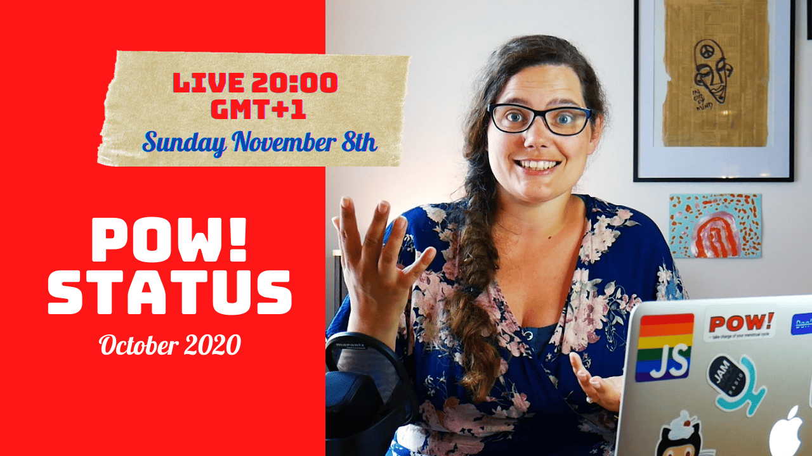

Hello,

Decided to try something different for the POW! October Status Update:

- I am doing it live at 20:00 (GMT+1) tonight, and you may ask questions and interact with the others in the chat.

You may also view it after the fact [at the same link](https://youtu.be/_V0JJrHNIb0).

If you are not in the mood for video, here is a quick summary:

- October ended with 41 customers, 4 new and 2 canceled.
- I started live streaming development work on POW! resulting in a new feature: "delete all entries" and finalizing the timeline redesign that's been on my mind since the summer.
- Marit ran four user testing sessions on existing POW! Customers and drafted a series of welcome emails based on the feedback.

I was very nervous before looking through the user testing sessions. However, it was a great experience — lots of constructive feedback and encouragement. Solidifying my belief that I am on the right path with POW! and I must just keep on keeping on. Improving the product and marketing little by little.

Hope to see you in the chat,\
Benedicte

**Streams**

- [Infinite timeline scroll](https://youtu.be/Q1qfEkHRPXw) // POW! Stream - #003
- [Timeline design](https://youtu.be/PeWnsLDX6l4) // POW! Stream - #002
- [Adding "factory restore"](https://youtu.be/70CpQRiOep8) // POW! Stream - #001

**Videos**

- [Privacy-first website analytics tools](https://youtu.be/u6Wkw7Wj-3Y) // Privacy in Practice - #002
- [Kind of a boring month](https://youtu.be/kFIztSAik7E) // POW! Update - September 2020
- [Privacy-first is more than encryption](https://youtu.be/X-9_-w7HFh0) // Privacy in Practice - #001
- [Getting organized and getting help](https://youtu.be/VK3_ItTBw6I) // POW! Update - August 2020
- [A perfect day in July](https://youtu.be/fpFY82efGPI) // Vlog
- [Passing 1000 USD in revenue](https://youtu.be/IFf8hFWR8J8) // POW! Update - July 2020
- [A day in June](https://youtu.be/P-4FUbiLv4Q) // Vlog
- [Why make POW! and plans](https://youtu.be/eRTJPIa39a4) // POW! Update - June 2020
