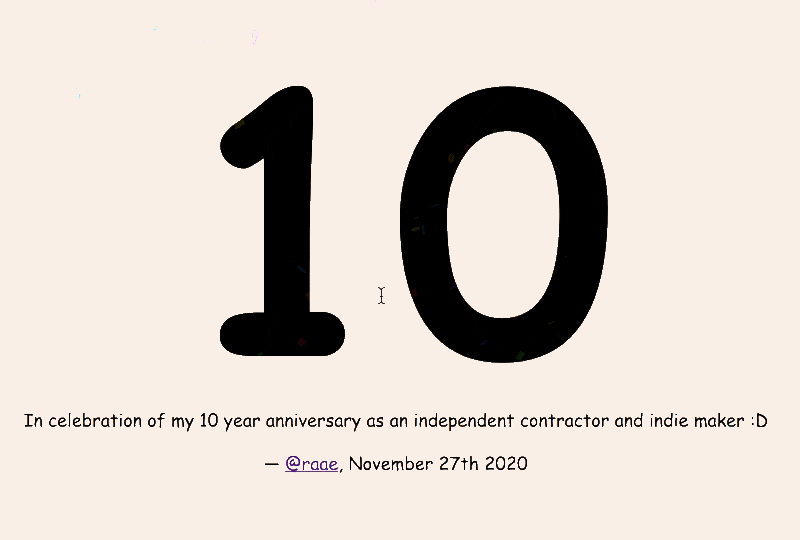

Hello,

Friday marked my 10th anniversary as an independent contractor and indie hacker!

This would probably have been an excellent time to write a long and profound article on what I have learned over the last decade of being self-employed.

Profound is not really my MO, so instead, I spent some time creating this fun page to celebrate myself 🎉

*I promise it looks better if you click it!*

**And I would love to make one for you!**

If you have something to celebrate. Let me know about it, and I'll send you your own confetti-filled personalized celebratory webpage.

Because we all need to be better at celebrating ourselves.

I almost let this opportunity for celebration pass. There were more "important" things I felt I "should" focus on.

But I am so happy I did not.

Celebrations are contagious, and I think we all need more fun, whimsy, and confetti in our lives.

So send me that thing you want to celebrate, however small—no need to wait until it's a 10th anniversary.

It will make me happy, and it will make you happy 😁

Until next week,\
Benedicte

PS: It's a [CodeSandbox site](https://codesandbox.io/s/10-year-anniversary-g39wm), so with only minimal coding knowledge, you can play around with it.
