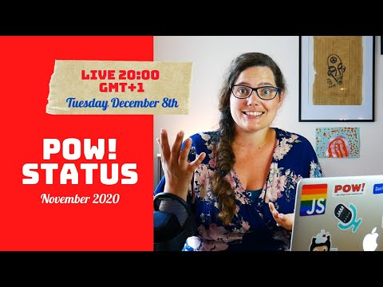

Hello,

On Tuesday, I streamed the POW! Status Update for November. Quite pleased with this one. If you would like to be notified an hour before I go live every month on the 8th, click here.

November was a good month for POW!

- 48 customers after 8 new people subscribed and 1 canceled.

Two features were added:

- Add/change the tag selected for menstruation
- Choose between three "Remember me" choices when signing in for more fine-grained control.

I kept on live streaming, even celebrating my [10th anniversary as an independent consultant and indie hacker on stream](https://youtu.be/ow4DDzMK4a4).

In December, however, I am not streaming POW! work, but streaming the making of our GatsbyJS #SillySiteChallenge entry ([bottledhappiness.app](https://bottledhappiness.app/)) every Sunday from 10.00-12.00 (GMT+1).

Marit did another four rounds of usability testing with potential customers. I am delighted to note that the design and copy resonates.

Ever since March, I have talked about a welcome sequence. I am slowly making progress, and the first email is done. It is performing well. My goal with it is to get a conversation started. So far, 5 out of the 6 who have received the email has answered.

I call that a win 🎉

Lastly, I got some **incredible feedback** from a canceled user on [how to visualize cycle data [GitHub]](https://github.com/raae/pow-app/issues/212).

Until next week,\
Benedicte

**All POW! Monthly Status Updates**

- [7 new customers in November](https://youtu.be/w50s_d_qkeo) // POW! Update - November 2020
- [First day of user testing](https://youtu.be/_V0JJrHNIb0) // POW! Update - October 2020
- [Kind of a boring month](https://youtu.be/kFIztSAik7E) // POW! Update - September 2020
- [Getting organized and getting help](https://youtu.be/VK3_ItTBw6I) // POW! Update - August 2020
- [Passing 1000 USD in revenue](https://youtu.be/IFf8hFWR8J8) // POW! Update - July 2020
- [Why make POW! and plans](https://youtu.be/eRTJPIa39a4) // POW! Update - June 2020
