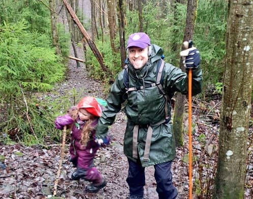

**Gledelig jul,**

Today, [on stream](https://youtu.be/9k2IFKC2jjo), I finished up [bottledhappiness.app](http://bottledhappiness.app/) 🎉

For now...

I am sure we will revisit this little app in 2021 as it has been delightful, making something silly just for funsies.

And my new year resolution is to make even more time for silly stuff.\
Maybe not always in the form of code tough...\
Sometimes the sillyness needs to happen IRL 🤪

**Do you have any silly plans for the new year?**

I have really been looking forward to my Sunday streams. Somehow they already feel like a integral part of my week.

So the plan is to keep it up 🗓️\
For the next couple of months I [will be streaming work on POW!](https://youtu.be/ZNhD4pXZOhI)

And to make sure I am not tied to the computer all Sunday, every Sunday, Lilly Labs (Ola, the Intern and I) will head into the woods when I am done streaming.

**Det finnes ikke dårlig vær, bare dårlige klær (There is no bad weather, only bad clothes.) - A Norwegian proverb we often heard as children and are now passing on to the next generation.**

Until next year,\
Benedicte

**#SillySiteChallenge Streams**

Today: [Wrapping Up and adding some CSS animations](https://youtu.be/9k2IFKC2jjo)\
Sunday 20th: [Custom bottle illustration](https://youtu.be/dWThML_ErkQ)\
Sunday 13th: [useBoop and useSound by Josh Comeau](https://youtu.be/a5dybGrxB5o)\
Sunday 6th: [Mostly wrangling with theme-ui - Stream 02](https://youtu.be/rjRL0C20NOU)\
Sunday 29th: [Getting the project up and running - Stream 01](https://youtu.be/gigaNsWQKVs)
