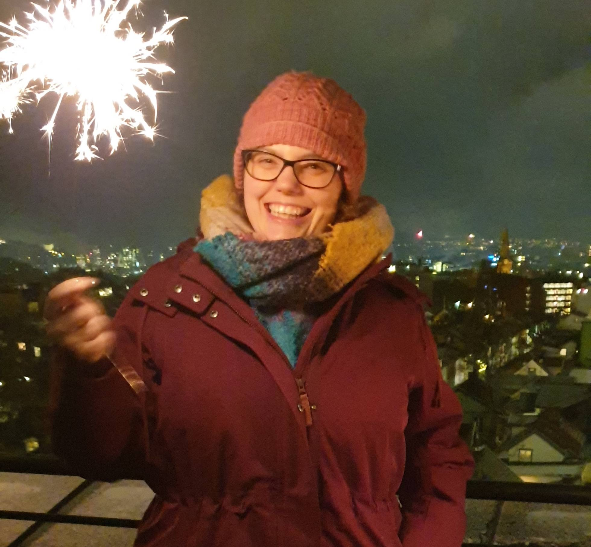

Hello there,

Can you believe it?\
I started sending these emails precisely 52 weeks ago!

That is a full year of weekly emails.\
Except for three tiny breaks, skipping a total of four emails.

It would have been so convenient to simply stop after missing a week (or two). But I didn’t, I came back to my practice. Writing 48 emails.

I think Seth Godin would be proud.\
(Totally recommend his latest book: [The practice](https://seths.blog/ThePractice/))

But most importantly, I am proud of me.

My identity from a very young age has very much been: bad at writing, good at science and math 👩‍💻

But keeping up this practice has shown that maybe, maybe that is not true. Maybe even I can become a good writer…

At least I no longer hate it; I think I am actually starting to enjoy it.

So here is to another full year of weekly emails 🥂

Until next week,\
Benedicte

PS. If you have not checked out [bottledhappiness.app](http://bottledhappiness.app/) yet, you most definitely should. I end up laughing every time; granted, I might be a little biased.

PPS. In the first [POW! Status Update - YouTube Live](https://youtu.be/JNMA4bg2-n0) of the year on Friday, I plan to do a recap of 2020 and share my POW! plans for 2021. Hope to see you in the chat!
