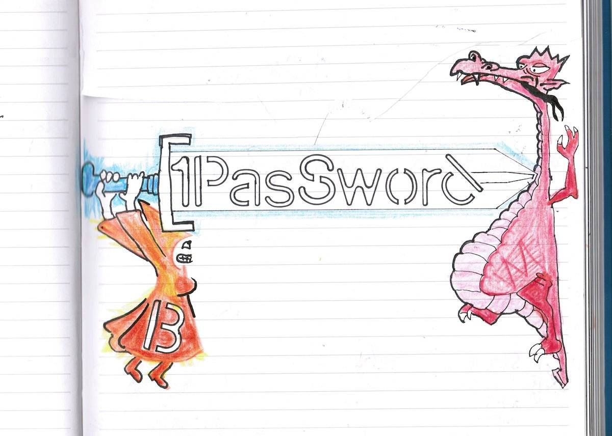

Hello there,

New year new opportunity to take charge of your passwords!

Here at Lilly Labs, we use the family plan from [1Password](https://1password.com/); it is perfect for a small family business like ours.

Without it I might not still have the secrets to access the weird cryptocurrency I got a year ago that is now worth around 9.000 EUR 🤯

We can share specific passwords within the family and also with guests like our [Virtual Assistant Monique](https://www.xn--sekretr-rxa.no/).

Setting it all up takes a little bit of focused time, but when that is all done, you may add one password at a time, no need to go bananaz and add all of them at once. But of course, you may!

*By co-founder, junior developer and dad of Lilly Labs ([@olaholstvea](https://twitter.com/olaholstvea))*

**Why 1Password?** I like their look and feel more than the competitions; I appreciate their business model and have had no trouble using it what so ever in the almost four years of using it.

After getting into it, you might even get your company on board with [the Business plan](https://1password.com/business/) 😎

Until the next one,\
Benedicte

PS: I am just a delighted customer, no affiliate commissions coming my way for doing this ;)
