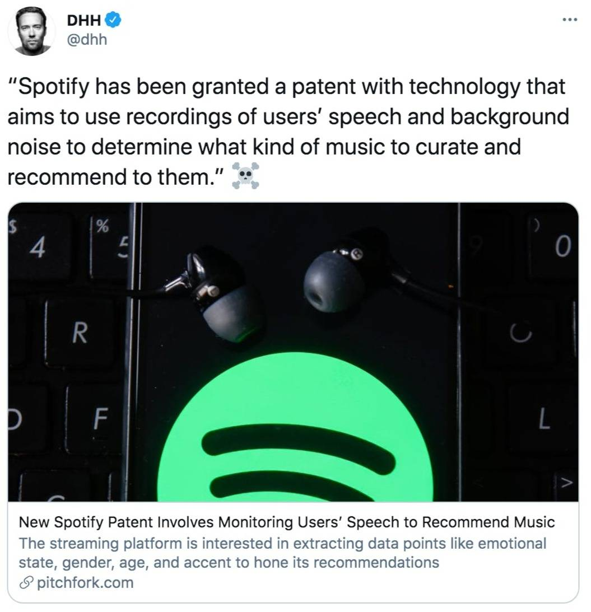

Hello there,

A tweet showed up in my feed this week...

*Link to [the tweet](https://twitter.com/dhh/status/1355036612569296897) and the [article referenced](https://pitchfork.com/news/new-spotify-patent-involves-monitoring-users-speech-to-recommend-music/) in the tweet.*

...that made me ask myself:

"Maybe we should have kept our CD collections like my good friend and [musician Eirik Myhr](http://eirikmhyr.no/)?"

I also remembered how we are served "better" ads [based on our Spotify listening habits [Guardian article]](https://www.theguardian.com/commentisfree/2018/sep/16/spotify-can-tell-if-youre-sad-heres-why-that-should-scare-you)...

Maybe it is a good thing we as a family share an account, mess up those algorithms a little!?!

Until next week,\
Benedicte

**More from this week:**

📺 Earlier today, on stream, [I explored Userbase's](https://youtu.be/lc10pjc4Yoo) built in payment feature.\
🎉 Our site bottledhappiness.app made the [Gatsby Silly Site Top 20](https://www.gatsbyjs.com/blog/2020-silly-site-top-20).\
🏆 Our friend Paul Scalion won the whole thing with [his entry BumHub](https://bumhub.netlify.app/).
