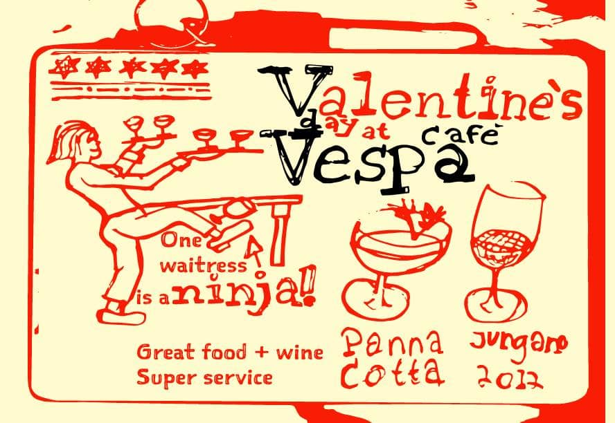

Hello there,

Happy Valentine's day and happy mother's day (if you are in Norway)!

I spent the [morning streaming](https://youtu.be/eHOYqtwfLns), and then all of Lilly Labs went for an offsite in the woods. Had it been any other year, Ola and I would soon head to Vespa for our traditional Valentine's dinner...

However, Vespa is more than our Valentine spot. It is my home away from home. I used it often as my office and even escaped there some evenings to watch Netflix and drink a glass of wine all by myself. It is also where we held the POW! launch party almost a year ago.

They are holding on by a thread and are asking for help via [bidra.no](https://bidra.no/prosjekt/vespa-og-humla-/b789c1ab-7040-41da-9078-b8eccee0092b).\
If you have money to spare, please consider donating.

*Ola's sketchnote from Valentine 2015*

Until the next one,\
Benedicte
