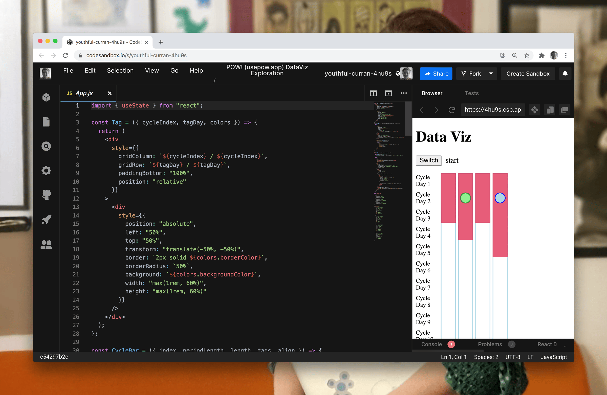

Hello there,

February Sunday Funday streams have been about exploring data visualization for POW!

I started testing out a framework built on top of the library that power most of the advanced visualization you see on the web today, D3.

Then post stream I was like, I am pretty sure this could be done without a heavy-duty framework.

No need to use a high tech blender to mix your pancake batter, when a whisk will do 🥞

The whisk in this scenario being CSS, and more specifically CSS Grid as it lets us position web content within a strict grid structure.

Easier said than done though, as I had no prior experience with CSS Grid.

At some point over the last 10 years it feels like I stopped absorbing new CSS knowledge, I knew enough to customize whatever template, library or framework I was working with.

I have obviously been loosing out. There are so many new and exiting thing in CSS like the Grid and variables and probably lots more I have missed.

Therefore I am eagerly awaiting Josh Camou's course, [CSS for JS devs](https://css-for-js.dev/). His blogpost are always top quality, so I am expecting the course to be as well.

But until then I managed to create a little [proof of concept viz](https://codesandbox.io/s/youthful-curran-4hu9s) that will be improved and added to POW! in March 👇🏼

Have a great week,

Benedicte

📺 Today, on stream, I worked on [automating some grunt work](https://youtu.be/00q8QeAmeVA) for the Fathom Analytics Gatsby Plugin, and I will do [so again March 14th](https://youtu.be/Ql9IGDVULkE).

📈 On March 8th 20:00 (GMT+1) you may join me for ["a year in review"](https://youtu.be/Ql9IGDVULkE). If you have any question you would like me to answer, let me know by replying to this email.
