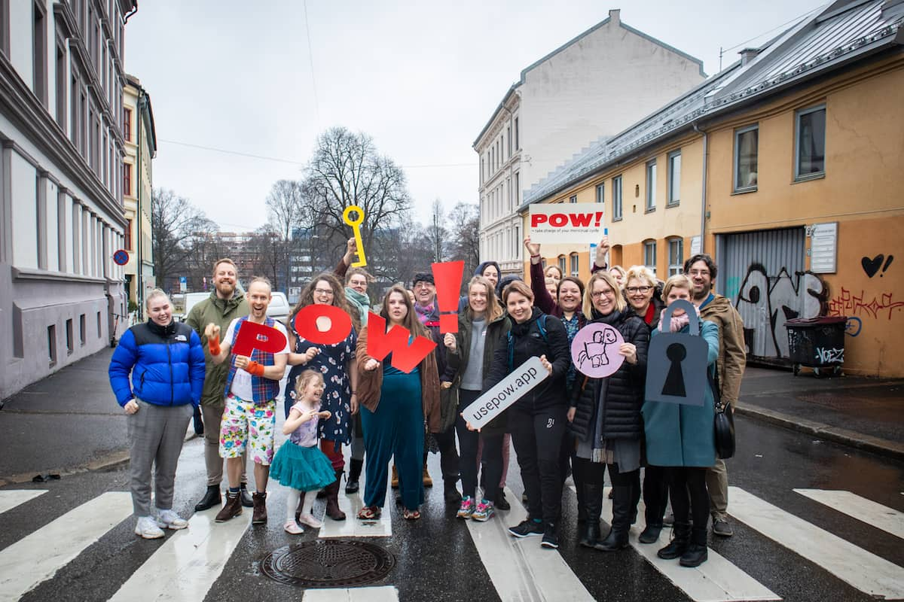

Hello there,

Tomorrow it's been a whole year since this happened:

The POW! Launch.\
What a magnificent day!

[You may see me sum it all up in this Twitter video](https://twitter.com/raae/status/1236745944751902728) 📹

In February, I finally managed to get onboarding emails fully automated. Super duper happy to get that done; it's been weighing me down...

Leaving February with 52 customers: 4 new and 3 canceled.

I think a great goal for the next year is to keep averaging one customer a week and slowly but steadily improve the product, hopefully improving churn.

Then in March 2022, it will be all about growth 📈

But first things first, let's celebrate 🎉 🎂 🥂\
You are hereby invited to attend one, some or all of the following:

[🎂 POW! Birthday Lunch](http://ko-fi.com/usepow/commissions) (in Norwegian)

- 13:00-13:45 (GMT+1 / 7:00-7:45 AM EST)
- [Sign up needed](http://ko-fi.com/usepow/commissions) · 4 USD · Limited to 15 people

[🥂 POW! Birthday Pre-Stream Party](http://ko-fi.com/usepow/commissions)

- 19:15-20:00 (GMT+1 / 1:15-2:00 PM EST)
- [Sign up needed](http://ko-fi.com/usepow/commissions) · 6 USD · Limited to 15 people

[🔴 POW! Status Update Stream](https://youtu.be/JNMA4bg2-n0) · Birthday edition

- 20:00-20:30 (GMT+1 / 2:00-2:30 PM EST)
- Free · Unlimited

[👩‍🏫 Toronto Jamstack Meetup](https://www.meetup.com/JAMstack-Toronto/events/276313928/) · 15 minute talk on POW!

- 21:00-23:00 (GMT+1 / 3:00-5:00 PM EST)
- [Sign up needed](https://www.meetup.com/JAMstack-Toronto/events/276313928/) · Free · Unlimited

Until next week,\
Benedicte
