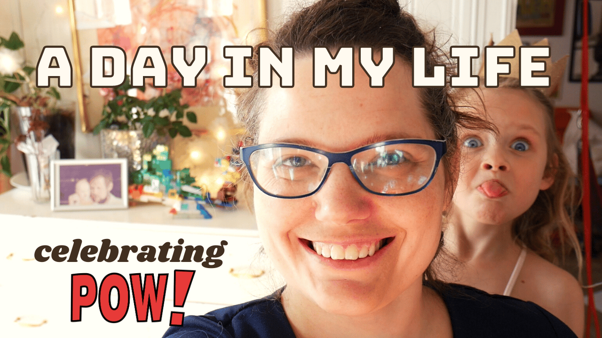

Hello,

Easter week is upon us here in Norway 🐣

The Intern will be taking Slalom lessons up in the city forest. Her favorite part of cross country skiing is going fast downhill (like her mom) so crossing my fingers for some happiness on the slopes.

On the topic of happiness, today is the day the vlog returns with [A day in my life celebrating POW!](https://youtu.be/Bk1jonYPFD4)

Hoping to do one a month now that I have an editor. Shoutout to [Belén](https://www.instagram.com/molen.audiovisual/), who took the footage and rolled with it.

Until next week,\
Benedicte

**A day in my life - vlog series**

- [Celebrating POW!](https://youtu.be/Bk1jonYPFD4) · March 2020
- [POW! Workcation at the cabin](https://youtu.be/fpFY82efGPI) · July 2020
- [An afternoon to myself](https://youtu.be/P-4FUbiLv4Q) · June 2020

**This week's streams**

[Talking through all the open POW! issues and closing one...](https://youtu.be/Ql9IGDVULkE)\
🔴 🎉 Sunday Funday Stream

[Adding MDX to my Gatsby site with help from the Natterpops](https://youtu.be/DugJk0P93rI)\
🔴 💬 Nattermob Friday Night Stream
