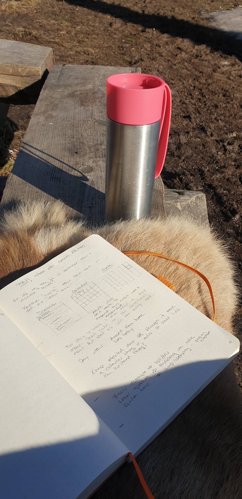

Hello there,

It's Easter Monday (a bank holiday) here in Norway.\
For all practical purposes, another Sunday, right?!?

Let me tell you I am so happy I signed the Intern up for slalom lessons.

30 minutes uphill (on my [whee.no](http://whee.no/) electric bike), and I felt transported to another realm.

Adult conversation IRL around the bonfire, the calmest and most competent instructors I have ever met, and a pretty decent ski resort?!?

I have lived in this city most of my life, but I still find new gems making a staycation all the better.

Next year I'll bring my snowboard 🏂

All the best,\
Benedicte

**This week's streams**

🔴 🎉 Sunday Funday Stream\
[Exploring Userlist messaging automation](https://youtu.be/8Ub3HL8Kv9g)\
🔴 🍻 Nattermob session\
 [Adding Open Graph images to Fabio's Gatsby site](https://youtu.be/3nJ3WRU7gO0)

**A day in my life as a developer, mom and indie hacker - series**

- [Celebrating POW!](https://youtu.be/Bk1jonYPFD4) · March 2020
- [POW! Workcation at the cabin](https://youtu.be/fpFY82efGPI) · July 2020
- [An afternoon to myself](https://youtu.be/P-4FUbiLv4Q) · June 2020
