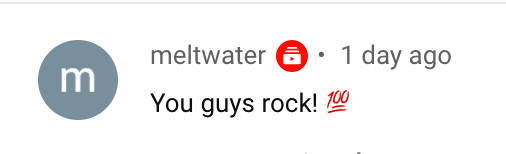

Hello there,

Just wanted to let you know:\
**People are great, or at least my users are!**

A while back, a user sent me a bug report about what seemed like a timezone issue in POW!

I followed up with some questions, she came back to me with answers and even a video showing the problem.

It was indeed a timezone issue and one that luckily was easy to fix ([embarrassingly so](https://twitter.com/raae/status/1382755159801991168?s=20)). I let her know it was fixed, and back came what I read as heartfelt "thank you."

How nice is that?!? It made my week together with this comment on my new streaming show ["Gatsby Deep Dives with me (Queen Raae) and the Nattermob Pirates"](https://youtube.com/playlist?list=PL9W-8hhRoLoN7axEFJQ17rJvk2KTiM2GP).

And to top it all off, spring has finally arrived here in Oslo, I spent much of the day soaking up the sun in a neighbor's backyard 😎

Until next week,\
Benedicte

**A day in my life as a developer, mom and indie hacker - series**

- [Celebrating POW!](https://youtu.be/Bk1jonYPFD4) · March 2020
- [POW! Workcation at the cabin](https://youtu.be/fpFY82efGPI) · July 2020
- [An afternoon to myself](https://youtu.be/P-4FUbiLv4Q) · June 2020

**This week's streams**

- 🔴 🎉 Sunday Funday Stream [Working on POW! — the privacy-first menstrual cycle journal](https://youtu.be/AFKtkJ-MS5U)
- 🔴 🍻 Gatsby Deep Dive with me (Queen Raae) and the Nattermob pirates [Automagically display the streams on the #Nattermob site](https://youtu.be/tJHV96jVlKg)
