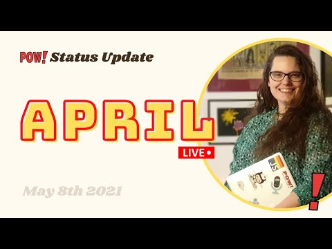

Hello there,

When I scheduled this month's status update, I titled it "0 new customers, but fun news non the less."

Turns out I was wrong; when I finally sat down and looked properly at the numbers, I found two new users. But also two cancellations resulting in 0 growth.

I often feel discouraged going to prepare these updates. But always come out excited about POW! and all that has happened.

- One of my dev heroes, [Sara Vieira](https://iamsaravieira.com/) will be working on POW! this month before starting her new gig.
- Content writer [Ingvild Borgestad Stander](https://www.xn--sekretr-rxa.no/menneskene-konseptet) will be working long term, but very part-time, on content for POW!
- POW! has always been technically open source, but I have started taking steps towards making it a welcoming and easy [project to contribute to](https://github.com/raae/pow-app).
- A talk by Plausible's marketing half, [Marko Saric](https://twitter.com/markosaric), got me all excited about my original strategy for POW! I will be not-so-secretly coping many of the things they have done.

Have a great week,\
Benedicte

**This week's streams**

- 🔴 🎉 POW! Status Update · April 2021\
  [0 new customers, but exiting news non the less](https://youtu.be/0qgy2y8h4qA)
- 🔴 🍻 Gatsby Deep Dives with Queen Raae and the Nattermob Pirates\
  [React Helmet for adding SEO and Open Graph Data to the site](https://youtu.be/_baKb3wZ5sg)

**A day in my life as a developer, mom and indie hacker - series**

- [Celebrating POW!](https://youtu.be/Bk1jonYPFD4) · March 2021
- [POW! Workcation at the cabin](https://youtu.be/fpFY82efGPI) · July 2020
- [An afternoon to myself](https://youtu.be/P-4FUbiLv4Q) · June 2020
