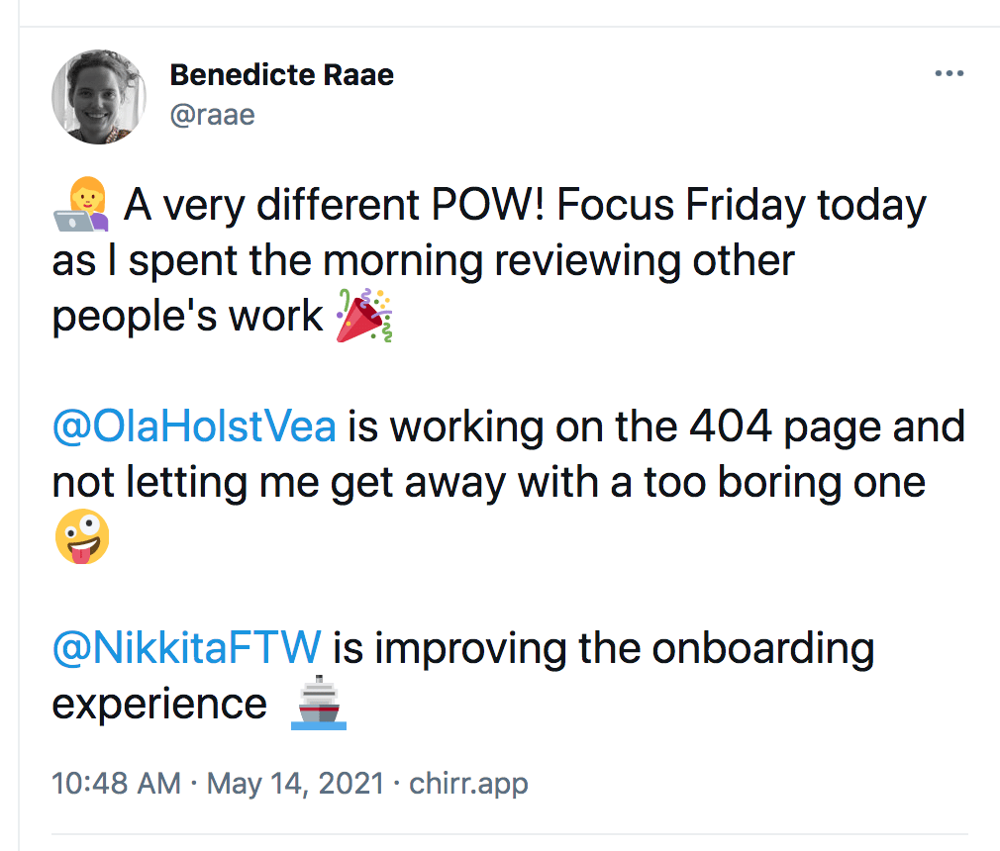

Hello there,

It takes a village to raise a SaaS (Software as a Service), and I am slowly gathering mine.

In the month of May, we are four people working on POW!

- React extraordinaire [Sara Vieira](https://iamsaravieira.com/) is improving the in-app onboarding experience.
- POW! Dev Junior Ola is creating the "404" page and has improved the "Change password" form.
- Content writer [Ingvild Borgestad Stander](https://www.xn--sekretr-rxa.no/om-oss) (found through my VA) is writing about how POW! is open source.
- And I am working on improving the data structure to be able to visualize the cycles better.

*A tweet from this week ;)*

Until the next one,\
Benedicte

**This week's stream**

- 🔴 🍻 Gatsby Deep Dive with me (Queen Raae) and the Nattermob pirates [Page specific SEO and Open Graph Data using React Helmet](https://youtu.be/hHehIwYilpA)

**A day in my life as a developer, mom and indie hacker - series**

- [Celebrating POW!](https://youtu.be/Bk1jonYPFD4) · March 2021
- [POW! Workcation at the cabin](https://youtu.be/fpFY82efGPI) · July 2020
- [An afternoon to myself](https://youtu.be/P-4FUbiLv4Q) · June 2020
