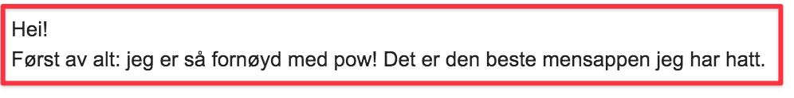

Hello again,

Today I got a bug report from a customer of POW!

It was even prepended by this lovely message:

Translation: First of all: I am so pleased with pow! It's the best period app I have used.

By doing so, she will forever be a part of the village raising POW!

If you want to make a founder's day, this is the way...

Until next time,\
Benedicte

PS: The bug was a [quick fix and is already solved](https://github.com/raae/pow-app/issues/296).

**This week**

- 🔴🍻[Live stream] [Image source magic with createRemoteFileNode: from remote URL to GraphQL](https://youtu.be/TfV9qGfNPJI) · Gatsby Deep Dives
- 🎙[Podcast] [Being an Indie Hacker and Part-time Creator with Benedicte Raae](https://candost.blog/sw-16-being-an-indie-hacker-with-benedicte-raae/) · Software World with Candost

**A day in my life as a developer, mom and indie hacker - series**

- [Celebrating POW!](https://youtu.be/Bk1jonYPFD4) · March 2021
- [POW! Workcation at the cabin](https://youtu.be/fpFY82efGPI) · July 2020
- [An afternoon to myself](https://youtu.be/P-4FUbiLv4Q) · June 2020
