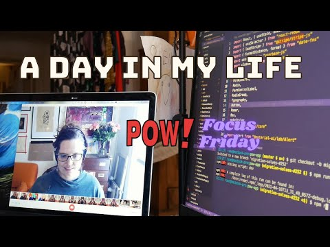

Hello there,

Follow along on very typical Friday in my life as a mom, founder, and developer: deleting code, making dinner, and ending the day the Gatsby Deep Diving Queen 👑

Cameos by [@userbase](https://twitter.com/userbase), [@monicalent](https://twitter.com/monicalent), the intern, [@OlaHolstVea](https://twitter.com/OlaHolstVea), my mom, [@GatsbyJS](https://twitter.com/GatsbyJS) and Pirate [@PaulieScanlon](https://twitter.com/PaulieScanlon) (in that order).

Have a good one,\
Benedicte

**This week's stream**

- 🔴 🍻 Gatsby Deep Dive with me (Queen Raae) and the Nattermob pirates [Trigger rebuilds with GitHub Actions and chatting with Jason Lengstorf](https://youtu.be/FFpplon6usI)

**A day in my life as a developer, mom and indie hacker - series**

- [POW! Focus Friday](https://youtu.be/TzJfepDjpzM) · Spring 2021
- [Celebrating POW!](https://youtu.be/Bk1jonYPFD4) · March 2021
- [POW! Workcation at the cabin](https://youtu.be/fpFY82efGPI) · July 2020
- [An afternoon to myself](https://youtu.be/P-4FUbiLv4Q) · June 2020
