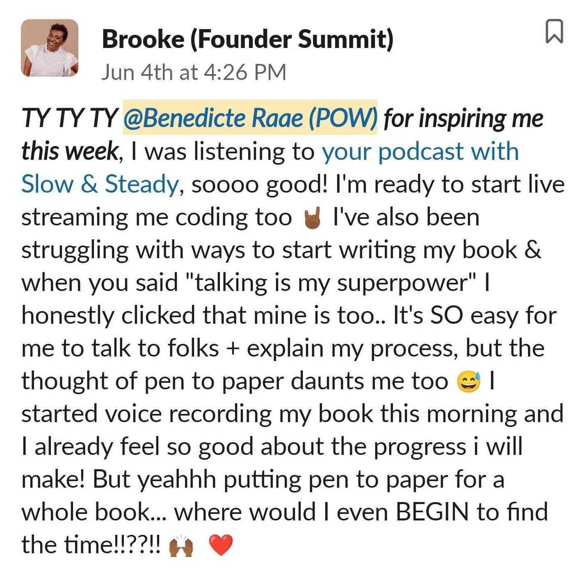

Hello there,

This week I was a guest on the [Slow & Steady podcast](https://twitter.com/benediktdeicke/status/1400002336823648257?s=20) with my “navnebror” Benedikt Deicke, co-founder of [Userlist](https://twitter.com/userlist).

We talked about how and why I became a build-in-public extremist by live streaming work on POW!

And how when talking is your superpower, it makes total sense to do so.

The conversation seems to have struck a chord with [Brooke](https://twitter.com/thisis_brooke) 🙌

Interested in streaming or Userlist?\
[Tune in tomorrow (Monday) at 10:00](https://youtu.be/xwGIS_gX_i8) when Benedikt helps me migrate POW! from ConvertKit to Userlist.

- We’ll migrate POW! Newsletter subscribers from ConvertKit using CSV export/import.
- We’ll hook up the Squarespace marketing site using Zapier.
- We’ll import existing users with Javascript straight from Userbase.
- If time permits: Update the Serverless Function that now adds new users to ConvertKit

Until next time,\
Benedicte

**Next week's streams**

- 🔴 🍻 Working on POW!: [Migrating to Userlist from ConvertKit with Userlist co-founder @benediktdeicke](https://youtu.be/xwGIS_gX_i8)
- 🔴 🍻 Gatsby Deep Dive with me (Queen Raae) and the Nattermob pirates: [-- Are we live? Gatsby Function with Gatsby founder Kyle Mathews](https://youtu.be/gG9E7ZYbhGo)

Click here if you would like to get an email reminder 30 minutes before I go live with a stream, and also remember to [subscribe to my channel](https://youtube.com/raaecodes) 🤪

**This week’s stream**

- 🔴 🍻 Gatsby Deep Dive with me (Queen Raae) and the Nattermob pirates [– Are we live? HTML Marquee Element 🤢](https://youtu.be/ag_318fBlIE)

**Latest Podcast Appearances**

- [Slow & Steady: Live Streaming with Benedicte Raae](https://twitter.com/benediktdeicke/status/1400002336823648257?s=20)
- [Software World: Being an Indie Hacker and Part-time Creator with Benedicte Raae](https://twitter.com/candostdagdevrn/status/1394561143843311620?s=20)
