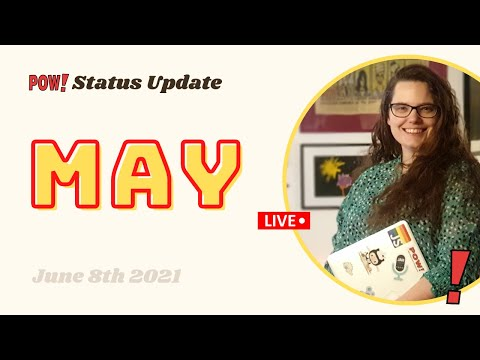

Hello there,

I am so happy I do these videos.\
They always renew my POW! energy 🎉🎉🎉

Lots of coding, some content, 5 new customers and 3 cancelations.

When the calendar view and some basic visualization are in place, it's time to revisit onboarding to ensure a higher percentage of users get value from POW! and stick around.

For a full report [watch the video](https://youtu.be/EtYSw2-xVZQ), or read [this Twitter thread](https://twitter.com/raae/status/1402341488739110915?s=20).

Until next week,\
Benedicte

**Interested in Gatsby Functions?** Reply with a “yes”, and I’l send you info about an idea in motion: Queen Raae’s Summer of Function

**This week’s stream**

- 🔴 🍻 Gatsby Deep Dive with me (Queen Raae) and the Nattermob pirates: [- Are we live? Gatsby Function with **Gatsby founder Kyle Mathews**](https://youtu.be/gG9E7ZYbhGo)
- 🔴📈 [Code, code and some content](https://youtu.be/EtYSw2-xVZQ) · POW! Status Update - Live · May 2021

**Latest Podcast Appearances**

- [Slow & Steady: Live Streaming with Benedicte Raae](https://twitter.com/benediktdeicke/status/1400002336823648257?s=20)
- [Software World: Being an Indie Hacker and Part-time Creator with Benedicte Raae](https://twitter.com/candostdagdevrn/status/1394561143843311620?s=20)
