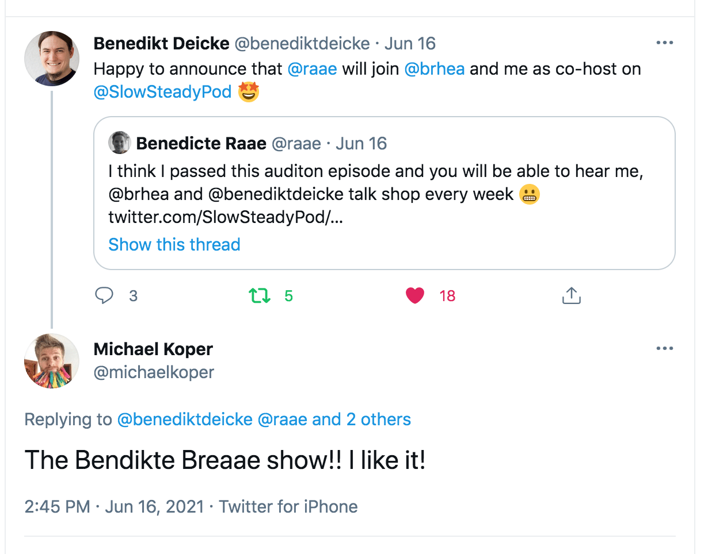

Hello there,

A couple of weeks back, I was a guest on the [Slow & Steady Podcast](https://www.slowandsteadypodcast.com/), and this week I was back as co-host.

It was not an audition (they said), but I nailed it anyhow, and I am now officially a co-host.

So if you’d like to hear Benedikt, Brian, and I talk shop every week, [subscribe to Slow & Steady](https://www.slowandsteadypodcast.com/) in your favorite podcast player.

Until next week,\
Benedicte

PS: If you are into Gatsby, check out [Gatsby Summer Functions](http://queen.raae.codes/) with Queen Raae and the Nattermob Pirates.
