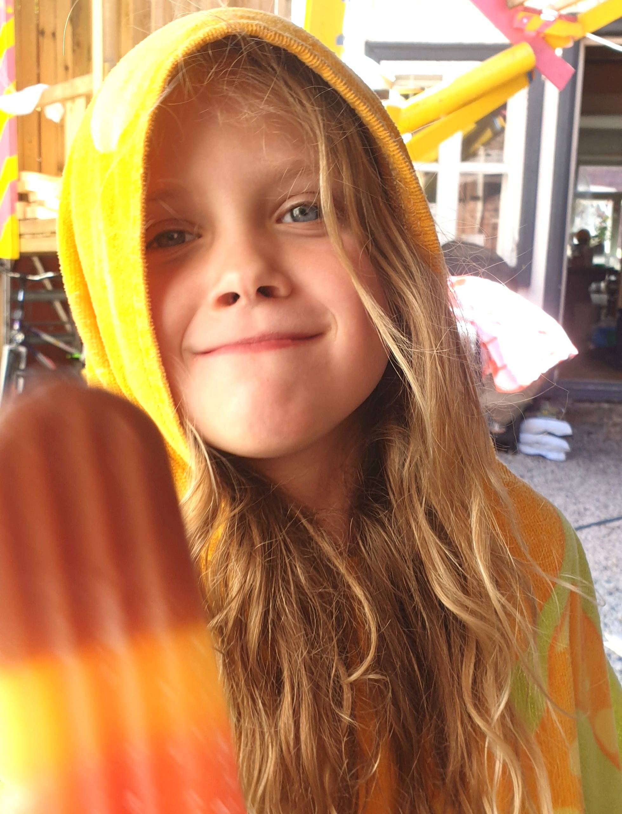

Hello there,

It's been a month since the last one. Did you miss the weekly updates?

I hope you've had a great summer so far!

We spent July mostly chilling at home. Going for swims in the Oslo fjord, hanging out with the neighbors, and even spending a night in the forest. First time ever for the Intern and the first time ever in a hammock for me.

*And lots of ice cream eating...*

No workcation at the cabin this year, but you (like me) can always [watch the vlog](https://youtu.be/fpFY82efGPI) from last year :D

My alter ego, Queen Raae has been hard at work hosting [Gatsby Summer Functions with Queen Raae and the Nattermob Pirates](http://queen.raae.codes/).

So far, it has been a blast. You can buy any of the [webinars as stand-alone purchases](https://www.crowdcast.io/raae), and there is even a free 3-hour 🤯 session on [securing your Gatsby Functions](https://www.crowdcast.io/e/securing-your-gatsby).

Without much attention [POW!](https://www.usepow.app/) gained 13 new customers in June and July. Not sure how many canceled, but I do find these numbers very encouraging 📈

Until next month,\
Benedicte
