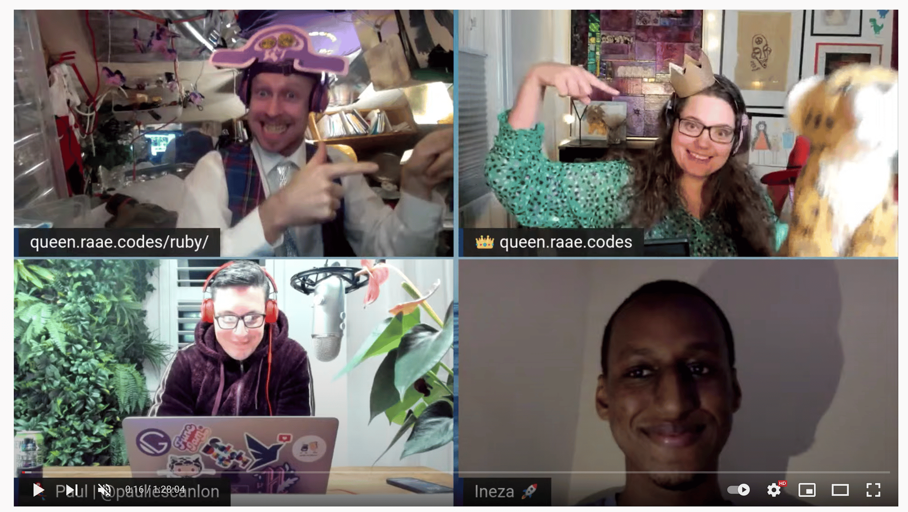
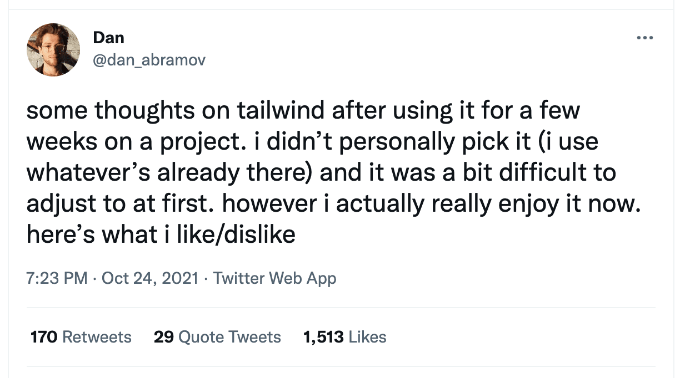

Hello there,

Yesterday's [unauthorized and rum-fueled](https://youtu.be/E2z9KU4V_h8) treasure hunts in the sharky waters around the Gatsby islands tiny-task was style one component.

It was time for our [nattermob.dev](https://nattermob.dev/) to look like it belongs in the 21st century. Paul suggested we reach for Tailwind. Since I knew [Ineza](https://twitter.com/inezabonte) has worked on Tailwind we asked him to join as well.

Personally I have either gone with [MaterialUI](https://mui.com/) for the utility web apps I've made, or just hand yolo'd my own css 🤪

I was pleasantly surprised!

It didn't feel as wrong as I thought it would... We followed the [Gatsby Tailwind](https://tailwindcss.com/docs/guides/gatsby) docs and went from there.

The biggest benefit I see is how lovely the default styling is. Often you are not looking to make something special, you are just looking to make something good enough.

Another benefit, especially for those with no design chops, are all the great examples. Especially if you pony up for the paid version of their [component playground](https://tailwindui.com/).

Not so interesting for us Gatsby folks, but since Tailwind is not dependent on Javascript you may use the same solutions for styling for projects on all stacks.

*Interesting thread/discussion on Tailwind by Rect Team Member Dan Abramov.*

All the best,\
Queen Raae

PS. The code [can be found on github](https://github.com/raae/nattermob.dev/pull/46/commits/ec62c1bab74db0dcf1a2705985ee3fff11bbeb21#diff-a6f3904c41211be170d9b0eb87e49ea8d02d0fd5a7224d6772174b425dacf90fR137) and we are not done styling! Grab an issue/component and style with us (after we document how to get the keys you need or find a work around) 👩‍🎨🧑🏽‍🎨👨🏻‍🎨

PPS: The website style I mentioned was popular a fairly recently was "Brutalist", check [out this showcase](https://brutalistwebsites.com/).
