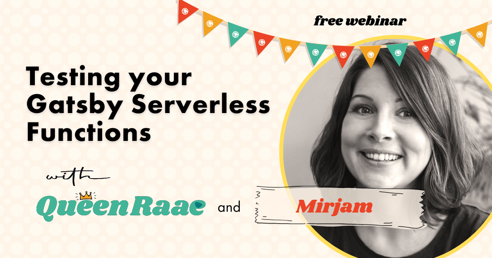

Hello there,

How can we bring TDD and testing to our Gatsby Functions?

Testing extraordinaire [Mirjam](https://twitter.com/mirjam_diala) shows us how in today's free webinar.

If you have any questions be sure to pop them in the questions tab, and we'll do our best to answer them.

See you soon,\
Queen Raae

PS: Make sure to check out the [Gatsby Mini Bootcamp](https://queen.raae.codes/gatsby-bootcamps/first-function) starting Saturday!
