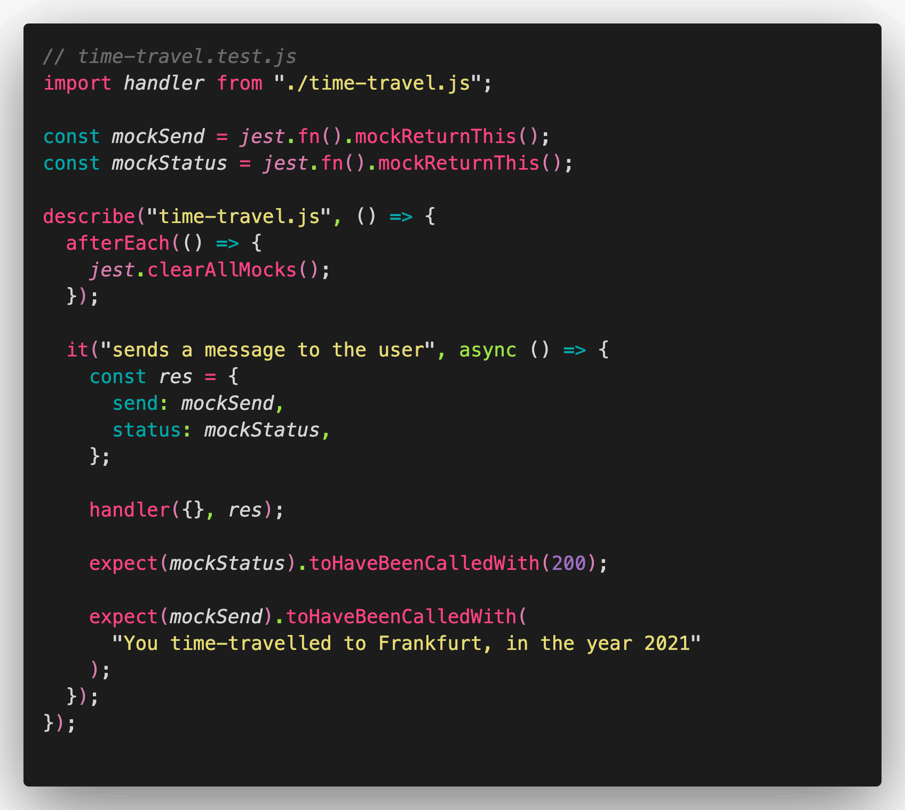
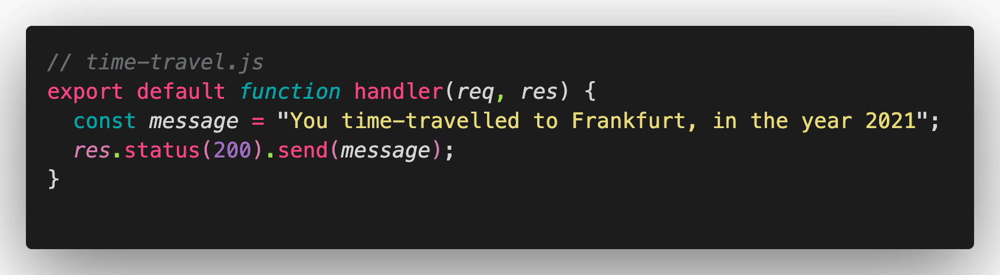
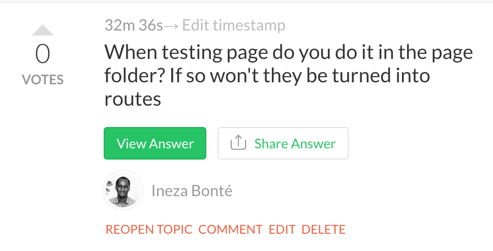
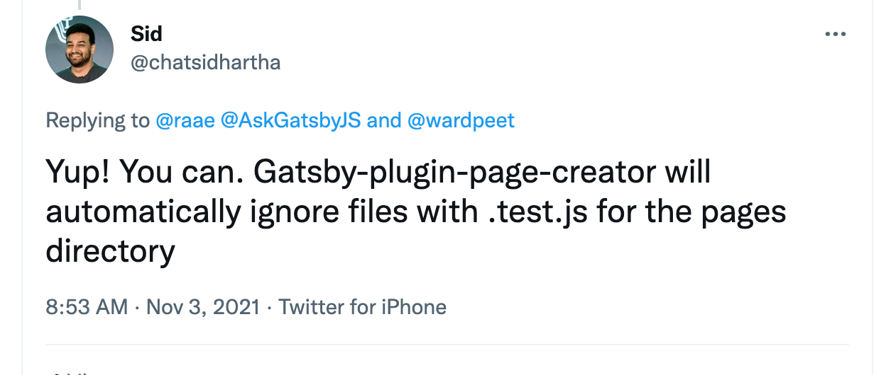
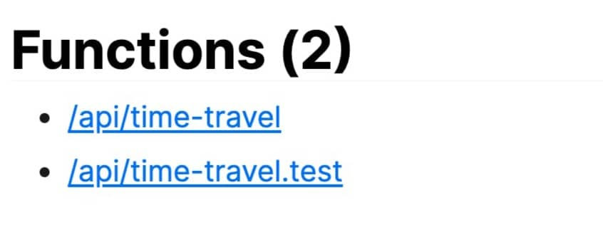

Hello there,

I have some testing experience, mostly after the code is written when a bug crops up and I would like to make sure it will not be let back in.

But true TDD, as I got to experience yesterday with Mirjam as my guide was new to me and so much fun 🎉

Seeing those test go from red to green, such a tight feedback loop!

To get started testing your Gatsby project follow [their setup guide](https://www.gatsbyjs.com/docs/how-to/testing/unit-testing/), Mirjam expressed delight in how it actually worked on the first try 🤯

For the webinar we focused on how to test your Gatsby Functions.

This took a little more effort to figure out how to do in a lightweight and robust manner. But I think the approach Mirjam came up with is awesome!

The approach is to mock the functions available on the response object, and then check to see if they have been called correctly.

For full examples [check out the code on GitHub](https://github.com/queen-raae/webinar-functions-testing/pull/1).

Both Mirjam and I like to have the test files next to the files we want to test ([link to our live answer](https://www.crowdcast.io/e/testing-your-functions/1/q/-MnX55vIHQp7jGXEx7fA)) and Ineza asked a great follow up question:

That I did not really know the answer to. It turns test files in the pages folder will not become routes, they are excluded 🥳

But not so for the api folder.

However I'll still keep them there (as they do no real harm) and hope the Gatsby team accept my request of excluding files in [the samme manner as for the pages folde](https://github.com/gatsbyjs/gatsby/discussions/33833)r.

**What is your take on testing?**\
Full on TDD? A little here and there?\
Reply and let me know.All the best,\
Queen Raae

**PS:** I will work some testing into the upcoming [Gatsby Functions Mini Bootcamp](https://queen.raae.codes/gatsby-bootcamps/first-function/), that's for sure 🤩
