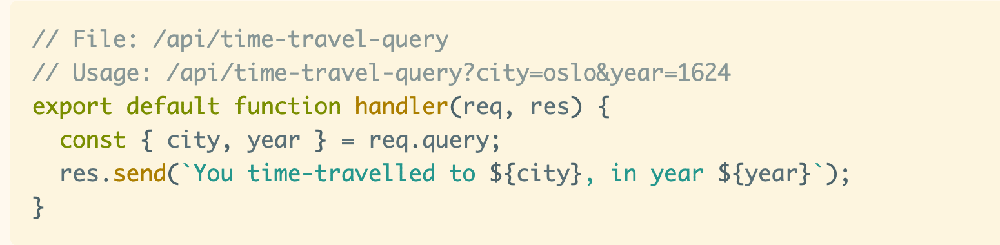
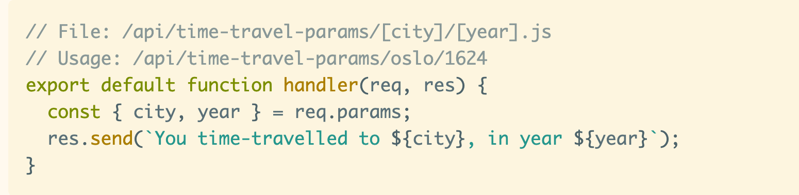
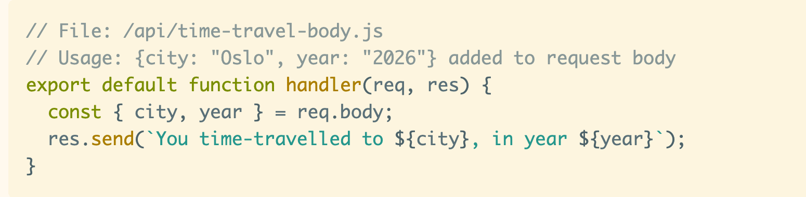

Hello there,

Getting started with Gatsby Function is easy peasy. You create a file in the src/api folder and copy/paste the hello-world example.

Hit the endpoint, and you get "Hello World" back.

And then you, like me, might think: "Okey, now what?"

Well, you can sign up for the [Mini Bootcamp starting Saturday](https://queen.raae.codes/gatsby-bootcamps/first-function/). We'll create a TimeShip that stores and fetches its travel data in/from a third-party service.

Or you can have a [look at the demo I just released](https://codesandbox.io/s/demo-data-functions-e9gtq) to learn how to get data into your Gatsby Functions in three different ways: req.body, req.params and req.query — getting you one step further!

The [demo is on CodeSandbox](https://codesandbox.io/s/demo-data-functions-e9gtq) meaning you can start playing around with it right away 🎉

All the best,\
Queen Raae

PS: If CodeSandbox is messing up you can also find the code on [Github](https://github.com/queen-raae/demo-data-functions).\
PPS: If you have any questions about the bootcamp or demo, hit reply!
