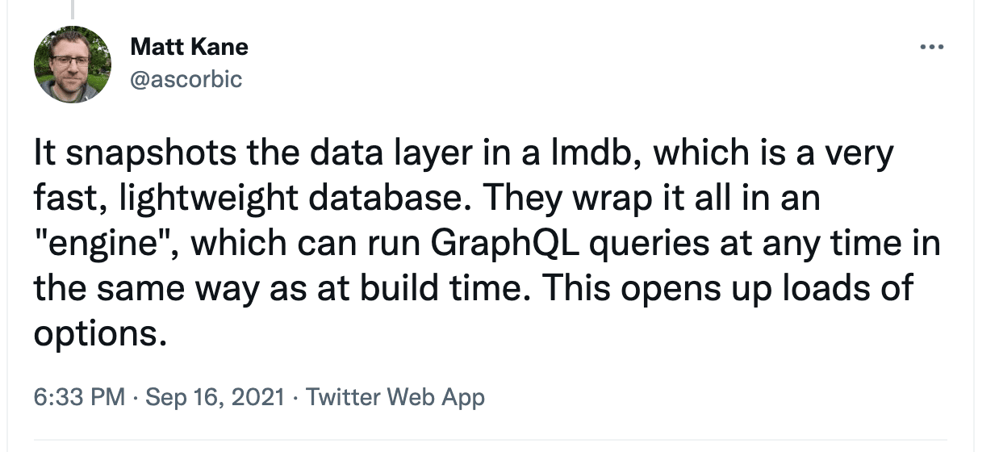

Hello there,

On [yesterday's unauthorized and rum-fueled treasure hunts](https://youtu.be/HUtjUBORi8U) in the sharky waters around the Gatsby islands, Kyle Mathews, the founder of Gatsby, joined us.

Our tiny task was to use [createNodeFields](https://www.gatsbyjs.com/docs/reference/config-files/actions/#createNodeField) instead of directly manipulating the node in onCreateNode, something we should never have done 😬

However, we kept circling back to Kyle's favorite tiny treasure deep down at the bottom of the Gatsby v4 treasure trove: LMDB (Lightning Memory-Mapped Database) ⚡️⚡️⚡️

Before LMDB, all the content sourced at build time was kept in memory, and then poof gone when the build completes.

With LMDB, all the content is there in a database, ready to be used at a later time. It is already it is put to good use with [DSG (Deferred Static Generation)](https://www.gatsbyjs.com/docs/conceptual/rendering-options/#deferred-static-generation-dsg).

With DSG the page is not rendered before someone visits that particular page, but the content used to fill it comes from the stored data fetched at build time.

It might not sound like much, but it makes it possible to be sure how the future rendered DSG page will behave. It does not matter if the API you are fetching content from is down or the content has changed; Gatsby will render the page [with content from the "snapshot" stored in the LMDB](https://www.gatsbyjs.com/docs/reference/release-notes/v4.0/#deferred-static-generation-dsg).

*Great thread from Matt Kane!*

One future possibility could be for Gatsby to automagically deploy the GraphQL API used at build time, giving us access to it alongside our other Serverless Functions 🤯

Why would we want that, well someone in the chat yesterday screamed "INFINIATE SCROLL" **— i**f that is a good thing or not I leave up to you to decide!

🤪

All the best,\
Queen Raae

**PS:** The code [can be found on github](https://github.com/queen-raae) and if you want to hang out wither other Gatsby/Nattermob fans check out the [discussions in the same repo](https://github.com/raae/nattermob.dev/discussions).

**PPS:** Wanna get started with Gatsby Functions and/or hang out with me and an already great group check [out the bootcamp starting tomorrow](https://queen.raae.codes/gatsby-bootcamps/first-function/).
