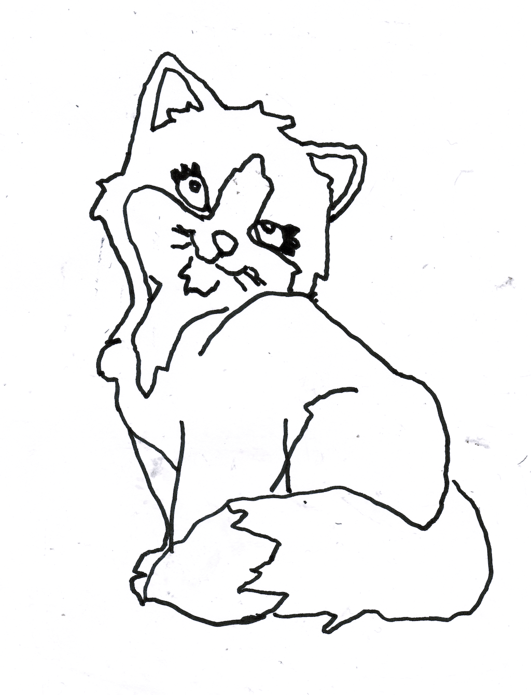
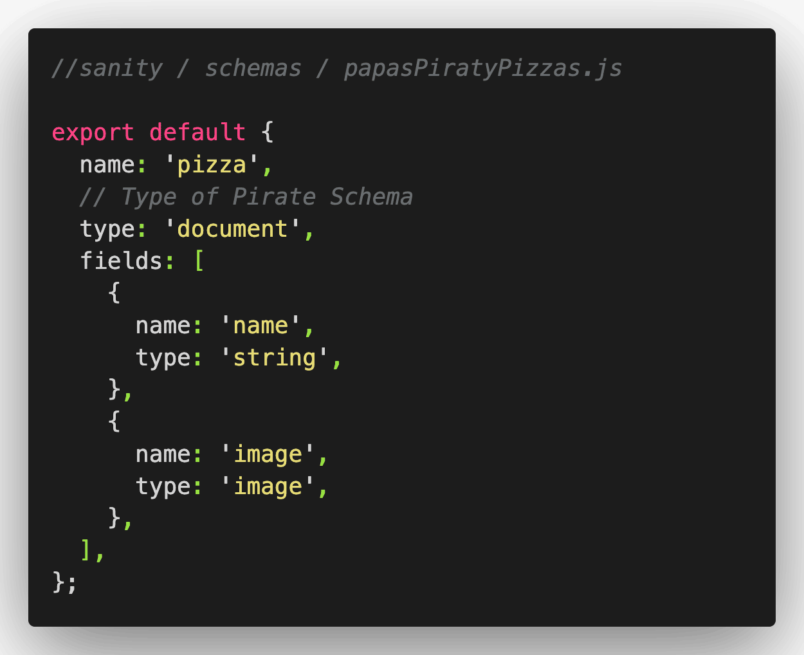
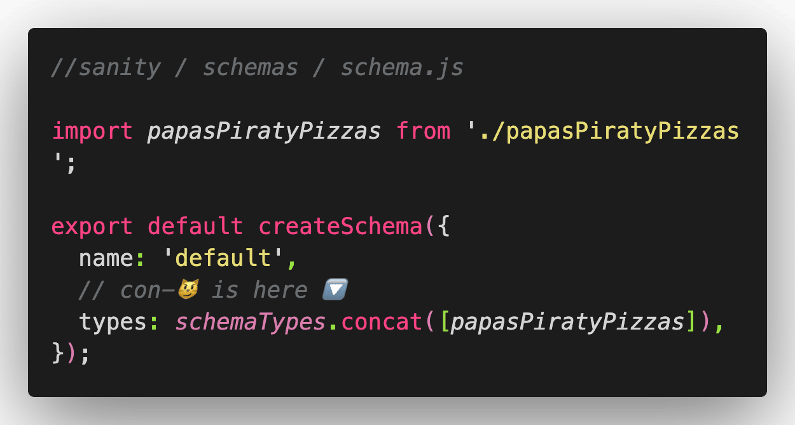

Ship Ahoy Skill Builder!

Tonight I'll be streaming unsupervised over on the [Queen's YouTube Channel at 20:00 CET](https://youtu.be/4nWUMgiEpdc)...**My tiny task this Sunday is:**

⬜️ Make it doable for my daughter Lillian (6 🏴‍☠️ 👸 ) to:

- Upload images of Lillian’s drawings from my data-machine to my Sanity.io on http://localhost:3333/desk/pizza 🖼️
- Name images of Lillian’s drawings, for example this one:

**What will I do?**

⬜️ Create a schema in Sanity.io\
⬜️ Add my schema to schema.js

**Why will I do it?**

I was working on my personal website when I got the idea to show images of Lillian’s projects and drawings.

Why is adding Lillian’s projects and drawings to my website making my skill building better?

Join [us live or check out the recording](https://youtu.be/4nWUMgiEpdc) of our podcast here to find out 📺

**How will I do it?**

The Steps

1. 😼 In sanity / schemas make a new pirate-schema-file: papasPiratyPizzas.js In sanity / schemas / schema.js add import papasPiratyPizzas from './papasPiratyPizzas'; In sanity / schemas / schema.js add papasPiratyPizzas inside your .con-😼 ([]), on line 16

Save and run your code, check localhost.

2. 🍕 Write an object: export default {}; Give it the type: 'document', Name it 'pizza',

Save and run your code, check localhost.

3. 🗻 Write an array: fields: []; Write an object and give it the type: 'string', and name it 'name',

Save and run your code, check localhost.

4. 🖼️ Write an object and give it the type: 'image', and name it 'image',

Save and run your code, check localhost.

Finished 🏴‍☠️

🔧😺👍

Keep your skill-building-submarine afloat this week!\
***— ***Ola Vea, Gatsby Piraty Captain

🔧⛵🏴‍☠️
