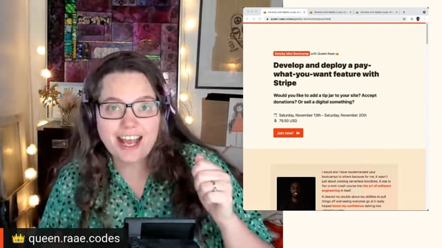

Hello there,

Would you like to add a tip jar to your site? Accept donations? Or sell a digital something?

Then maybe next week's Mini Gatsby Bootcamp is something for you. Choose to work on your own site, or the supplied TimeShip project 🚀

**Why pay-what-you-want?**

It's a great feature to let you play with more of an advanced Stripe flow. Pay-what-you-want is not possible (yet at least) with Checkout Link; you need to create the Stripe Checkout on a server. Perfect fit for a Gatsby Serverless Function.

We'll also look at how to automatically fulfill the purchase using a webhook to send a custom email.

**What you'll learn?**

- How to approach the project and split it into **manageable tasks**.
- The **structure** of a typical Serverless function.
- How to **handle secrets** both in development and production environments.
- The joys of **data validation** and **error handling**!
- How to **deploy** to Netlify or Gatsby Cloud.
- What **webhooks** are and how to make them using Gatsby Functions.
- How to create **Stripe Checkout Sessions** server-side to support **pay-what-you-want** and add metadata used in fulfillment.
- When to use a **Server-Side Rendered** (SSR) page.

**What is a Gatsby Mini Bootcamp**

A Gatsby Mini Bootcamp is a webinar + q&a session + forum + co-working + code sample combo; read more about the program over on [queen.raae.codes](https://queen.raae.codes/gatsby-bootcamps/payment/).

The price is 79.50 USD with a "Choose your own Purchasing Parity Discount"-policy. Meaning you can pay as little as approx 12 USD if you for any reason feel you qualify.

[Save your spot](https://queen.raae.codes/gatsby-bootcamps/payment/) today already 🎉

All the best,\
Queen Raae

**PS:** Would you rather be interested in a code sample + video walk-through + forum version? Ie. A no live sessions, take-it-at-any-time version?

**PPS:** Anything you would like to see me offer in terms of Gatsby training, let me know. I am working on the best way to serve a mix of free and paid content.
