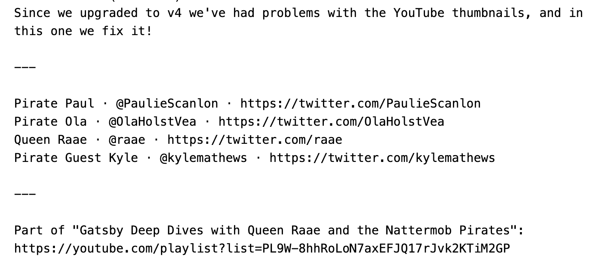
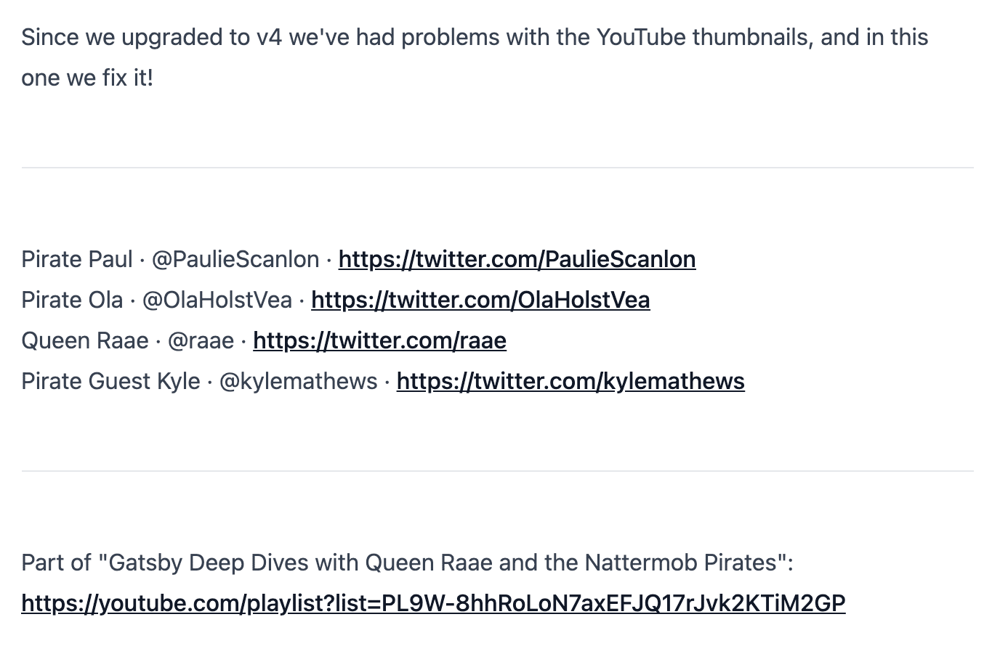
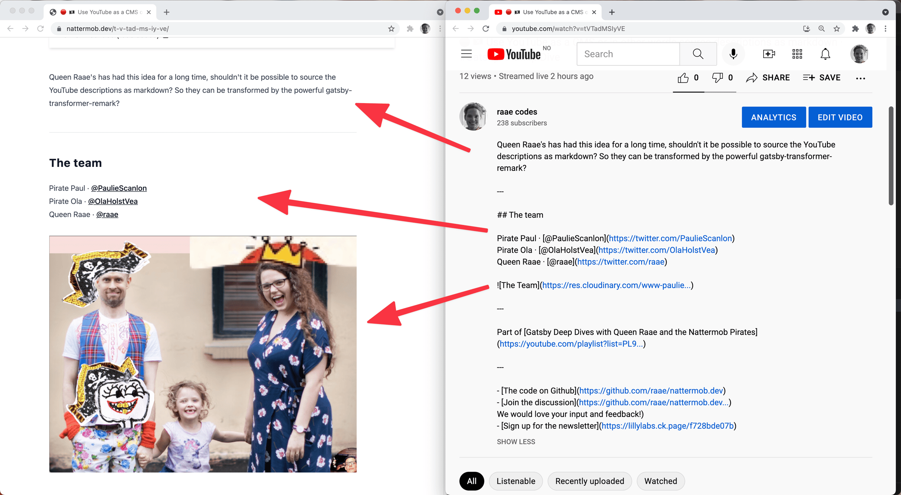
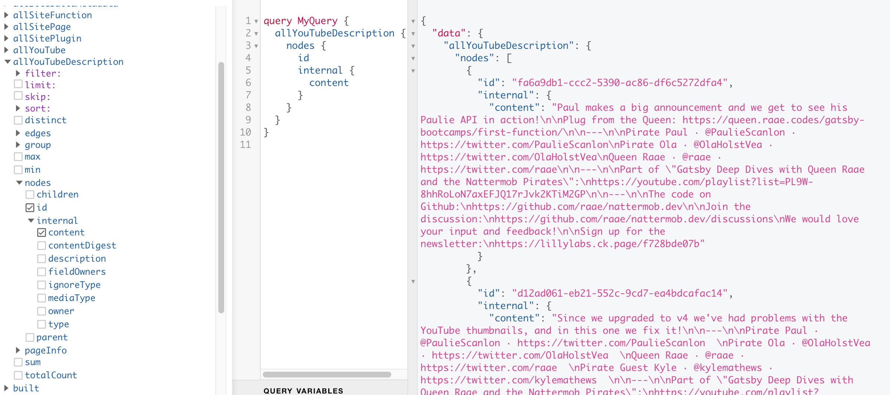
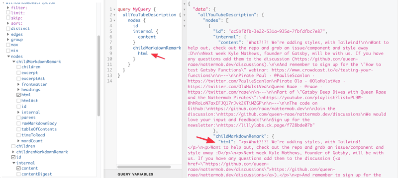
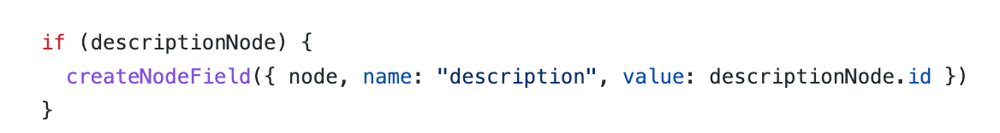
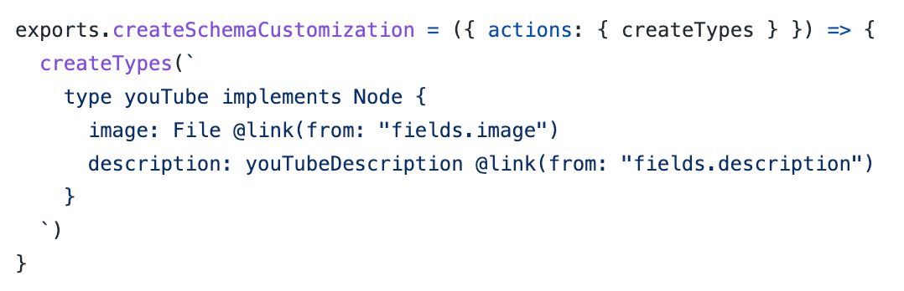
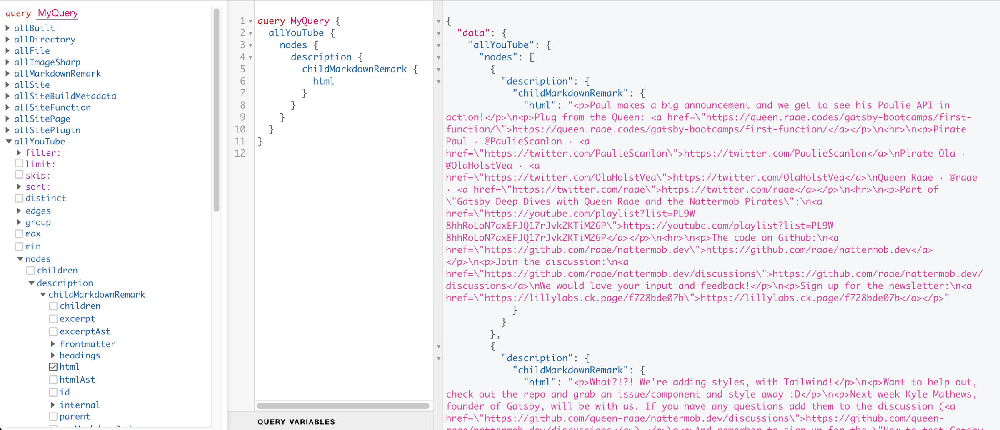

Hello there,

[Yesterday's unauthorized and rum-fueled](https://youtu.be/tVTadMSIyVE) treasure hunts in the sharky waters around the Gatsby islands tiny-task: create markdown nodes from YouTube descriptions.

Summarized succinctly by Ola: "Oh, so you are using YouTube as a CMS!"

**Why, you might ask?**

We would like nicely formatted HTML on our Gatsby site, but YouTube's description is a basic string.

Before yesterday's stream, we simply put the string in a pre-element so that line breaks and other crucial white space was preserved.

*Basic string in a pre element.*

However, a great way to make the transformation is to treat the basic string as markdown. Line breaks become paragraphs (

), URLs become proper links () etc.

*The basic string treated as markdown.,*

But even better, by treating the description as markdown we can use all of markdown's features. And since markdown is fairly readable, it still looks okey on YouTube.

**Treating the YouTube description as markdown**

We create a description node with **mediaType set to "text/markdown"** and the content set to the basic description string for every YouTube node.

➡️ [View the](https://github.com/queen-raae/nattermob.dev/blob/d5bcd4d7de431cf178ac98caac7d5be2ee08c902/gatsby-node.js) [complete](https://github.com/queen-raae/nattermob.dev/blob/d5bcd4d7de431cf178ac98caac7d5be2ee08c902/gatsby-node.js) [code](https://github.com/queen-raae/nattermob.dev/blob/d5bcd4d7de431cf178ac98caac7d5be2ee08c902/gatsby-node.js)

*Create description node, inside [onCreateNode](https://github.com/queen-raae/nattermob.dev/blob/d5bcd4d7de431cf178ac98caac7d5be2ee08c902/gatsby-node.js).*

*The created YouTubeDescription nodes*

By using "text/markdown" as the mediaType, the nodes will be picked up and transformed into MarkdownRemark nodes by [gatsby-transformer-remark](https://www.gatsbyjs.com/plugins/gatsby-transformer-remark/) plugin when installed and configured.

The plugin will also link the parent node (our YouTubeDescription) to the MarkdownRemark node, making it available as childMarkdownRemark.

It treats our YouTubeDescription the same way it would a markdown file sourced from the file system, the typical approach for a markdown Gatsby blog.

*After adding gatsby-transformer-remark*

**Linking the YouTube Nodes to the YouTubeDescription for convenience**

We could have stopped there. But I wanted a convenient way to query for the HTML on the YouTube node, not just on the YouTubeDescription node. The reason is easy access in our **{youTube.slug}.js** pages.

First we save a reference to the YouTubeDescription node by adding a field using createNodeField.

*Create a reference for later in [onCreateNode](https://github.com/queen-raae/nattermob.dev/blob/d5bcd4d7de431cf178ac98caac7d5be2ee08c902/gatsby-node.js).*

In createSchemaCustomization, we link the YouTubeDescription node to description on the YouTube node using the id we saved above 🤯.

*🎉 Markdown description on the YouTube node 🎉*

➡️ [View the full code](https://github.com/queen-raae/nattermob.dev/blob/d5bcd4d7de431cf178ac98caac7d5be2ee08c902/gatsby-node.js)

**Finally, render the description as html**

To do so, we updated the page query in our **{youTube.slug}.js** pages to include the above query and used the result to add the HTML to the page by utilizing dangerouslySetInnerHTML...

➡️ [View the full code](https://github.com/queen-raae/nattermob.dev/blob/d5bcd4d7de431cf178ac98caac7d5be2ee08c902/src/pages/%7ByouTube.slug%7D.js)

What I went through here is my first attempt at a solution, it might change in the future. I would love to hear from you if you have any suggestions for improving the code!

All the best,\
Queen Raae

PS. The code [can be found on github](https://github.com/raae/nattermob.dev/pull/46/commits/ec62c1bab74db0dcf1a2705985ee3fff11bbeb21#diff-a6f3904c41211be170d9b0eb87e49ea8d02d0fd5a7224d6772174b425dacf90fR137) and you are encouraged to chime in under [discussions in the same repo](https://github.com/raae/nattermob.dev/discussions).
